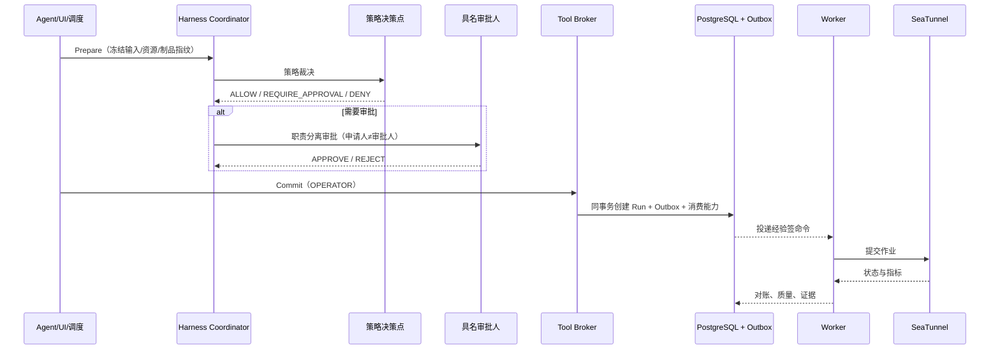
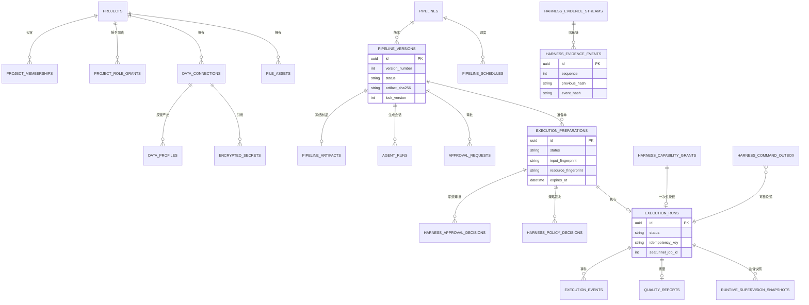

# 《etl_agent》产品需求文档（PRD）

> | 文档名称 | etl_agent 需求规格说明书（PRD） |
> |----------|----------------------|
> | 版本 | v1.2 |
> | 作者角色 | 产品经理 |
> | 日期 | 2026-10-14 |
> | 状态 | 评审稿（已按参考实现与评审意见核对） |
> | 环境范围 | **测试 / 演示环境；暂不考虑生产环境** |
> | 需求来源 | 《尚硅谷大模型项目之生产级ETL-Agent.md》第 0 章；`prompt/prd.prompt` |
> | 事实校验来源 | 参考实现 `../etl_agent`：`domain/enums.py`、`domain/state_machine.py`、`domain/harness.py`、`domain/side_effects.py`、`domain/supervision.py`、`application/harness_policy.py`、`application/execution_harness.py`、`application/runtime_supervision.py`、`infrastructure/models.py`、`config.py`、`benchmarks/harness-v2/v1/*` |

**一句话定位**：etl_agent 是**企业 ETL 任务的智能控制面**——理解自然语言需求、探查受管元数据、生成候选方案、解释风险、请求具名审批并跟踪执行结果；**真正的数据搬运交给 Apache SeaTunnel Zeta**。产品只做一件事并做到底：**模型只负责"提建议"，从建议到真实副作用的每一道关口都由确定性代码和具名的人把守。**

**阅读约定**：文中 `P0/P1/P2` 为功能优先级（P0 必须）；`P0–P3` 若出现在风险语境则指风险等级。涉及安全边界、状态迁移、审批分离、证据留存的条目均为**可验证断言**，不是设计建议。凡标注"代码事实"的条目均已对照 `../etl_agent` 实现。

**环境口径（本轮确认）**：本期聚焦**测试 / 演示环境**，**暂不考虑生产环境**。因此生产专属内容——K8s / 多可用区 / HA、**企业 KMS/HSM（本期明确不使用）**、企业部署系统对接、多租户与配额、生产高可用 SLA——**均不在本期范围**；文中凡标注"生产阶段适用"的约束（如可信网关强制）**保留为设计不变量**，但本期不交付、不作为验收项。

---

## 1. 产品目标与价值

### 1.1 背景与要解决的问题

企业数据集成的输入很少是完整技术规格。业务方往往只说一句：

> 把 MySQL 的订单同步到 Doris，清理客户名称，金额必须为正，邮箱要脱敏，错误数据单独保存，每天凌晨执行。

这句话背后隐藏大量必须补齐的工程事实：源/目标是否属于本项目、表和字段是否真实存在、类型能否对齐、是否允许空值、错误表保留哪些列、全量还是增量、重试会不会重复写入、由谁批准、失败如何回滚。目前这些全靠人工翻译成 SeaTunnel 配置，导致：

- **需求到实现的转换靠人**：字段映射、质量规则、拒绝行去向、增量窗口靠经验与口口相传。
- **制品没有治理**：配置散落于文件与工单，"某次写入用的是哪一版配置"无法回答。
- **权限与责任脱节**：能改配置的人往往也能直接跑作业；审批是"看一眼"，不绑定不可变制品。
- **风险看不见**：无界全表扫描、输出放大、拒绝率异常、凭据外发，出事之后才知道。
- **副作用无人统管**：启动作业有审批，人工取消、回滚、清理、凭据轮换却各自直连引擎——同类风险，多套安全语义。

### 1.2 建设目标

把"控制面"建成一条可验收的端到端主线：


系统采用 **"Agent 处理不确定性、Workflow 管理稳定次序、Harness 强制安全边界"** 的混合方案：

| 组件 | 解决的问题 | 交付形态 |
|---|---|---|
| Agent | 在不完整输入下澄清与生成候选 | LLM 适配器、受控上下文、有限修复 |
| Workflow | 步骤如何排序、中断、恢复与收敛 | LangGraph + PostgreSQL Checkpoint |
| Harness | 谁能调用什么工具、带来哪些影响、失败如何阻断与取证 | PDP、Tool Broker、审批、Capability、Outbox、监督、证据 |
| Data Plane | 如何稳定、可扩展地搬运数据 | SeaTunnel Zeta 与官方连接器 |

**规模口径（已确认，代码事实）**：第一版为**单团队 / 单层项目模型**——多个项目并列存在，项目内用 `ProjectRole`（`ADMIN/DATA_ENGINEER/APPROVER/VIEWER`）+ 可叠加 `HarnessRole` 分权；**没有租户/组织层，也没有项目配额**（`Project` 实体仅有 `id` 与 `name`）。跨项目隔离由确定性规则 `HARNESS-P0-CROSS-PROJECT`（跨项目资源范围直接 `DENY`）与所有业务资源的 `project_id` 归属共同保证。

**并发口径（已确认）**：本期**只需测试环境可用，单 Worker 即可**；**不设多 Worker、不做队列隔离 / 优先级 / 并发上限**（保持实现最简单）。

### 1.3 成功标准（可量化）

| 目标 | 衡量指标 | 目标值 |
|---|---|---|
| 高风险操作零漏放 | Benchmark `p0_p1_block_rate`（所有高风险非正常案例被拒绝或要求审批） | **100%** |
| 合法任务不被误伤 | Benchmark `legitimate_success_rate` | **≥95%** |
| 误报受控 | Benchmark `false_positive_rate` | **≤5%** |
| 关键动作可追责 | Benchmark `evidence_coverage_rate`（每个案例产出可审计规则证据） | **100%** |
| 结果可复现 | Benchmark `reproducibility_rate`（同案例重复执行观察一致） | **100%** |
| 控制面不拖慢 | Benchmark `non_llm_p95_max_regression`（相对冻结基线） | **≤20%** |
| 秘密不落明文 | API 响应 / 审计 / 日志 / Trace / 证据 / 消息队列 / Prompt / 图状态中凭据与原始敏感样本出现次数 | **0** |
| 端到端可交付 | Golden Case（订单清洗）行数与错误码符合固定基准 | **4 行入表 + 4 行入错误表，4 个错误码正确** |

---

## 2. 用户角色与权限矩阵

### 2.1 角色清单

| 角色 | 职责描述 | 核心权限 |
|------|---------|---------|
| **企业数据工程师**（主要用户） | 把一句业务话变成可执行、可审批、可回放的 Pipeline | 建连接/Profile、上传文件、描述需求、生成候选、提交业务审批、发起副作用申请 |
| **数据审批人** | 在不读全量 HOCON 的前提下判断风险并承担责任 | 审批 Pipeline 版本；占执行 Preparation 的数据审批槽 |
| **安全审批人** | 掌控破坏性操作、数据外发与凭据使用 | 裁决安全提案；影子/小流量/推广授权；占 P0 破坏性操作的安全槽 |
| **运行操作员** | 可靠地提交、观测、取消、重跑、回滚、清理副作用 | Commit Preparation、取消、原产物重跑、撤销/回滚安全发布 |
| **审计员** | 独立复核"谁、何时、基于什么、做了什么" | 只读核对身份分离、摘要链一致、证据签名、确认无 Secret 明文 |
| **项目管理员** | 管理项目成员与普通配置 | 成员管理、职责授予；**不隐式获得安全审批权** |

### 2.2 权限矩阵（谁可发起 / 谁可批准 / 谁可执行）

| 动作 | 发起 | 审批 | 执行（Commit/Worker） |
|---|---|---|---|
| 创建连接 / Profile / 上传文件 | 管理员、数据工程师 | — | Worker |
| 启动 Agent 生成 | 管理员、数据工程师 | — | Worker（LangGraph） |
| 提交版本审批 | 管理员、数据工程师 | 管理员、数据审批人（**非申请人**） | — |
| 生成执行 Preparation | 管理员、数据工程师 | 按风险等级决定职责槽 | — |
| Commit 执行 | — | — | **运行操作员** |
| 取消执行 | 管理员、数据工程师 | 自动 Commit | Worker |
| Doris 回滚 `ROLLBACK_DORIS` | 管理员、数据工程师 | 数据审批人（P1，1 人） | Worker |
| Doris 清理 `CLEANUP_DORIS` | 管理员、数据工程师 | **双人（P0）** | Worker |
| Secret 迁移/激活/回退 | 管理员、数据工程师 | 数据审批人（P1，1 人） | Worker |
| Secret 暂存/验证 | 管理员、数据工程师 | 可由一次性能力自动执行 | Worker |
| Secret 销毁 `DESTROY_SECRET` | 管理员、数据工程师 | **双人（P0）** | Worker |
| 运行 Benchmark | 数据工程师 / 审计员 / 安全审批人 | — | 服务端内置套件 |
| 创建安全提案 | 数据工程师 | — | 不执行 |
| 裁决/影子/小流量/推广 | — | **安全审批人（非创建者）** | 只产出签名授权，由部署系统执行 |

**职责分离规则（不可协商）**：
1. **申请人 ≠ 审批人**（`requested_by != decided_by`），对版本审批、执行 Preparation、回滚、清理、全部 Secret 操作、安全提案一律适用。
2. **同一自然人不得占用同一份 Preparation 的两个审批槽**（服务校验 + 数据库唯一约束双重兜底）。
3. **P0 破坏性操作需要两个不同职责槽**：数据审批人 + 安全审批人，且为**两个不同自然人**。
4. 上述约束由**硬编码策略规则 + 数据库唯一约束**（`harness_approval_decisions` 上的 `(preparation_id, role)` 与 `(preparation_id, decided_by)`）双重实现，**不存在任何配置开关可降级**为"同一人不同职责"。
5. 演示环境的身份切换只是模拟自然人，**不能用一个账号轮流扮演申请人与审批人**完成四眼流程。

---

## 3. 用户故事

- **US-01**：作为**数据工程师**，我希望用一句话描述需求就能得到一份可审查的 Pipeline 候选，以便不再手写 HOCON。→ FR-05 / FR-06
- **US-02**：作为**数据工程师**，我希望系统在不清楚增量水位列时主动向我澄清，并在补充后从同一会话继续，以便不必重新描述整段需求。→ FR-07
- **US-03**：作为**数据工程师**，我希望上传的 CSV/JSON/Parquet 等文件被统一解析为受管资产，以便不必手工处理编码与字段规范化。→ FR-03
- **US-04**：作为**数据审批人**，我希望审批页展示目标表、影响、风险、回滚与**制品摘要**，以便在不读全量配置的情况下承担责任。→ FR-08
- **US-05**：作为**安全审批人**，我希望删除类与凭据销毁类操作强制"双职责、双自然人"，以便不可逆操作不被单人放行。→ FR-09 / FR-12
- **US-06**：作为**运行操作员**，我希望只有具备操作员职责的人才能提交执行，且提交前系统会重新校验审批与制品，以便授权不被绕过。→ FR-09
- **US-07**：作为**运行操作员**，我希望失败原因被确定性分类（可重试与否）而不是让我看一段引擎日志，以便决定重跑还是改需求。→ FR-10
- **US-08**：作为**运行操作员**，我希望取消、重跑、回滚、清理都走同一个受管控制面，以便同类风险共用一套安全语义。→ FR-12
- **US-09**：作为**审计员**，我希望关键决策形成不可篡改的证据链，并能独立复核身份分离与摘要一致，以便被判责时可自证。→ FR-09
- **US-10**：作为**安全审批人**，我希望策略改动先经过冻结 Benchmark 与影子/小流量验证，出现 P0/P1 回归自动回滚授权，以便合法任务不被大规模误伤。→ FR-15
- **US-11**：作为**数据工程师**，我希望 ETL 任务能按 cron 与水位增量每日自动执行且不重复写数，以便无人值守运行。→ FR-14
- **US-12**：作为**项目管理员**，我希望通过一次性初始化建立项目与身份边界，成功后永久关闭入口，以便部署安全。→ FR-01

---

## 4. 功能需求清单（需求池）

> 编号规则：`FR-<模块>-<序号>`。P0 必须 100% 覆盖主流程；P0/P1/P2 = 必须/重要/可选。

| 编号 | 模块 | 功能 | 优先级 | 说明 |
|------|------|------|--------|------|
| FR-01 | 身份、项目与初始化 | 项目/成员管理、可叠加职责授予、一次性 Bootstrap、双模式身份来源、领域异常→HTTP 映射、健康检查 | P0 | 在调用模型前建立业务真相与身份边界 |
| FR-02 | 数据连接与元数据探查 | 登记连接、连通性测试（异步）、表级探查、Profile 快照、Adapter 内脱敏、标识符白名单 | P0 | 让 Agent 获得可靠数据上下文，同时不把密码交给模型 |
| FR-03 | 受管文件资产 | 流式上传、原子落盘、九格式解析、规范化与保守推断、编译为 LocalFile Source | P1 | CSV/JSON/JSONL/XLSX/Parquet/ORC/XML/Markdown/PDF |
| FR-04 | 凭据治理 | 双后端 Provider、轮换、回退、跨 Provider 迁移、销毁、到期告警与 Webhook | P0 | 凭据只在 Worker 调 Adapter 前短暂存在于内存 |
| FR-05 | ETL 契约表达 | Schema/质量/增量/交付契约、dry-run、design_review、制品绑定（逐行 LLM 契约能力保留但 **不启用**） | P0 | 版本化显式契约限定平台事实 |
| FR-06 | 候选生成 | 生成端口、`direct` 与 `seatunnel-cli` 双路径、三类结果、供应商中立、前置护栏、就绪检查 | P0 | 每份候选只调用一次 Provider |
| FR-07 | Agent 可恢复会话 | 六节点状态图、共享修复预算、独立检查点、恢复语义、状态最小化、幂等 | P0 | 把"一次模型调用"变成显式、可恢复、有预算上限的流程 |
| FR-08 | 版本冻结与四眼审批 | 四类对象职责分离、冻结流程、摘要定义与校验、版本血缘、审批决策一次性 | P0 | 审批绑定内容，不只绑定数据库 ID；审批单无有效期字段 |
| FR-09 | Harness 执行内核 | Prepare、PDP 策略裁决、Approve、Commit、Capability、Tool Broker、事务 Outbox、证据账本 | P0 | 本产品最核心、不可绕过的确定性运行时 |
| FR-10 | 执行、观测与失败诊断 | 唯一创建路径、稳定作业标识、三种动作区分、幂等键、状态映射、指标归一化、确定性失败分类 | P0 | 迟到错误不得改写已确认终态 |
| FR-11 | 质量契约与 Doris 原子发布 | 单次读取双路隔离、可追溯、质量报告、运行级影子表、原子交换、幂等发布 | P0 | 引擎成功不等于质量通过 |
| FR-12 | 统一副作用治理 | 副作用闭集（9 类）、两层职责、统一流水线、封闭性约束、租约、双重证明 | P1 | 全部已支持副作用收敛到同一 Harness，不允许旁路 |
| FR-13 | 运行时监督与数据分级 | 六维预算、六条确定性规则、动作优先级、数据分级传播、可解释话术 | P1 | 风险扩大时只收窄权限地介入 |
| FR-14 | 调度与水位增量 | 调度模型、切换版本重置水位、到期扫描、跳过语义、水位窗口 `(lower, upper]`、只在成功后推进 | P1 | 调度只创建 Preparation，不直接执行 |
| FR-15 | 仿真、Benchmark 与安全进化 | 三层验证（L0/L1/L2）、六项冻结门槛、14 个冻结场景、受控安全进化 | P1 | P0/P1 漏拦是硬失败，不被高分抵消 |
| FR-16 | Web 控制台 | 五个视图（总览/数据连接/Studio/运行中心/安全治理）、统一 API 边界、状态不夸大 | P1 | 真相源始终是 PostgreSQL；**本期单文件实现，不拆分** |

**P0 主流程覆盖**：FR-01 → FR-02 → FR-04 → FR-05 → FR-06 → FR-07 → FR-08 → FR-09 → FR-10 → FR-11 完整覆盖"需求→生成→冻结→审批→授权→执行→发布→留证"主线。

---

## 5. 非功能需求（量化）

| 类别 | 要求 | 指标 |
|------|------|------|
| 安全 | 秘密不落明文 | API 响应/审计/日志/Trace/证据/MQ/Prompt/图状态/制品中出现次数 = 0 |
| 安全 | 失败关闭 | 策略、审批、签名、证据或 Secret 无法验证时不得降级放行 |
| 安全（生产阶段适用） | 生产身份来自可信网关 | **本期不涉及**（保留为设计不变量，不作验收项） |
| 性能 | 确定性路径延迟 | 非 LLM 路径 P95 相对冻结基线退化 ≤ 20% |
| 性能 | 生成调用 | 单份候选一次调用，超时默认 180s（上限 600s）；候选总量 ≤ 3 份 |
| 性能 | 执行监控 | 轮询默认 2s（节流 5s）；监控总时长上限约 1 小时 |
| 容量 | 元数据样本 | 每次探查样本 ≤ 100 行 |
| 容量 | 单文件上传 | ≤ 25 MiB；单次解析 ≤ 100000 行 |
| 容量 | 运行预算 | 记录数 ≤ 1000 万、字节数 ≤ 10 GiB、时长 ≤ 3600s（均可收紧） |
| 规模 | 部署形态 | 单团队/单层项目；**无多租户、无项目配额** |
| 规模 | 运行并发 | **测试环境单 Worker 即可**；**不设多 Worker、无队列隔离 / 优先级 / 并发上限**（保持实现最简单） |
| 可用性 | 至少一次投递 + 业务幂等 | 重复消息不产生第二次副作用、第二个作业或第二份秘密 |
| 可用性 | 崩溃可恢复 | API 提交后崩溃可由 Outbox 扫描恢复；Worker 崩溃租约可过期重认领 |
| 可用性 | 心跳与离线判定 | Worker 心跳默认 10s，陈旧阈值默认 35s |
| 合规 | 凭据年龄 | 最长 90 天、提前 14 天预警（连接级可配） |
| 合规 | 审批/授权时效 | 版本审批单**无有效期字段**；Preparation 24 小时；Capability 5 分钟（硬上限 15 分钟） |
| 合规 | 回滚保留 | Doris 回滚版本保留 7 天；Secret 回退窗口 7 天；**全局配置，不做差异化** |
| 可观测 | 全链路追踪 | API/Agent/Celery/外部 HTTP/SQLAlchemy/引擎提交可按 Trace ID 关联；OTLP **默认关闭** |
| 可观测 | 脱敏采集 | 不采集请求体、SQL 绑定参数、业务样本、HOCON、Prompt、Secret、错误原文 |
| 兼容 | 供应商中立 | 候选生成模型通过通用环境变量切换供应商，不绑定单一前缀；逐行 LLM **默认关闭、不作为交付能力** |
| 兼容 | 秘密后端可迁移 | 支持本地密文与外部 KV 双后端及迁移期路由；**本期不使用 KMS/HSM** |
| 可维护 | 代码质量门禁 | 静态检查、严格类型检查、单测覆盖、依赖审计全部通过 |
| 可维护 | 前端交付 | 本期保持**单文件前端、不拆分**；**不做多语言与无障碍** |

---

## 6. 核心业务流程图

### 6.1 端到端主流程（受管执行的 11 步事实链）


### 6.2 执行授权协议（prepare → approve → commit）



---

## 7. 关键页面原型说明

### 7.1 总览

```
+--------------------------------------------------------------+
| 项目: 订单域   [切换工作区 v]            角色: 数据工程师      |
+--------------------------------------------------------------+
| 到岸指标: 今日成功 12 / 失败 1   待办 Preparation: 3          |
| 就绪连接: MySQL(READY) Doris(READY)   文件资产: 5             |
+--------------------------------------------------------------+
| [数据连接] [Pipeline Studio] [运行中心] [安全治理]            |
+--------------------------------------------------------------+
```

### 7.2 数据连接

```
+--------------------------------------------------------------+
| 连接卡片: 名称 | 类型 | host:port | 状态 | [测试] [探查]       |
+--------------------------------------------------------------+
| Profile 列表: 表名 | SOURCE/SINK | 样本量 | 过期时间          |
|   └ 点击查看脱敏样本（邮箱 ***@domain / 密码 [REDACTED]）     |
+--------------------------------------------------------------+
| 受管文件: 文件名 | 格式 | 行数 | 状态         [+ 上传文件]    |
+--------------------------------------------------------------+
| Secret 生命周期: 轮换/迁移/回退/销毁 状态与审批入口          |
+--------------------------------------------------------------+
```

### 7.3 Pipeline Studio

```
+--------------------------------------------------------------+
| Provider 就绪: READY   Agent 控制台时间线: [生成][澄清][修复] |
+--------------------------------------------------------------+
| 需求输入框（≤20000 字符）                                     |
| 契约: [质量规则] [增量水位] [交付模式]  (逐行 LLM: 隐藏)      |
+--------------------------------------------------------------+
| 方案审查: DAG | Schema Diff | 风险 | 脱敏Before | 结构预览    |
|           | 冻结 HOCON                                        |
+--------------------------------------------------------------+
| [生成] [提交审批] [批准] [生成 Preparation] [审批] [Commit]    |
|  └ 无 OPERATOR 职责时 Commit 按钮禁用                         |
|  └ 自批时提示"当前身份是审批申请人，不能自批"                |
+--------------------------------------------------------------+
```

### 7.4 运行中心

```
+--------------------------------------------------------------+
| 执行台账: RunID | 版本 | 状态 | 触发 | 开始 | 耗时           |
+--------------------------------------------------------------+
| 详情页: 监督快照 | 失败诊断 | 质量报告 | 事件时间线 | Trace  |
|   └ 监督动作: CONTINUE/THROTTLE/PAUSE/CANCEL/QUARANTINE       |
+--------------------------------------------------------------+
| 凭据到期预警 | 轮换治理清单 | Doris 回滚保留清单              |
+--------------------------------------------------------------+
| [刷新] [取消] [原产物重跑] [申请回滚] [申请清理]              |
|  └ 提示："Commit 成功 ≠ ETL 成功"；"节流 ≠ 降低读取速率"     |
+--------------------------------------------------------------+
```

### 7.5 安全治理

```
+--------------------------------------------------------------+
| Benchmark 门禁指标卡: p0_p1_block_rate | legit_success | ...  |
|   └ 版本间 delta，未通过的报告也保留                           |
+--------------------------------------------------------------+
| 提案审查列表: 类型(POLICY/PROMPT/BENCHMARK) | 状态 | 创建者   |
+--------------------------------------------------------------+
| 签名运行卡片: 影子 | 5% 小流量 | 推广授权 | [撤销/回滚]       |
|   └ 提示："推广授权 ≠ 已自动更新生产"                        |
+--------------------------------------------------------------+
```

---

## 8. 数据实体初稿（ER）



**核心状态机（拒绝跳步、非法回退、终态重启）**：

- `PIPELINE_TRANSITIONS`：`DRAFT→PROFILING→GENERATED→VALIDATED→WAITING_APPROVAL→{APPROVED, REJECTED}`；`APPROVED`、`REJECTED` 为终态。
- `AGENT_RUN_TRANSITIONS`：`QUEUED→{RUNNING, FAILED}`；`RUNNING→{WAITING_INPUT, WAITING_APPROVAL, FAILED}`；`WAITING_INPUT→{QUEUED, FAILED}`。
- `EXECUTION_TRANSITIONS`：`QUEUED→{SUBMITTED, FAILED, CANCELLED}`；`SUBMITTED→{RUNNING, FAILED, CANCELLING}`；`RUNNING→{SUCCEEDED, FAILED, CANCELLING}`；`CANCELLING→{CANCELLED, FAILED, SUCCEEDED}`。

---

## 9. 验收标准（AC）

| 功能（FR） | 验收条件（前置—操作—预期） |
|-----------|--------------------------|
| FR-01 | 给定 Bootstrap 已成功一次，当再次调用，则应返回 409 且不创建项目；给定未配置初始化开关 / 令牌，调用应被拒绝。 |
| FR-02 | 给定已登记连接，当创建探查任务，则 API 立即返回 202，Profile 保存 Schema、近似统计与脱敏样本，且**不保存原始业务行**；探查结果的邮箱为 `a***@domain`、密码类为 `[REDACTED]`。 |
| FR-04 | 给定任一连接操作，当返回 API 响应与写入普通日志，则**看不到明文凭据或秘密引用**；Secret 销毁失败时不得返回成功。 |
| FR-05 | 给定质量契约 v2 某条规则缺少机器可判定谓词，当提交生成，则该候选被确定性门禁拒绝，且**不进入人工审批中断**。 |
| FR-06 | 给定生成 Provider 未配置，当发起生成，则返回 `NOT_CONFIGURED` 并列出缺失配置项，**绝不返回 Key 值**，也**不发起收费模型调用**。 |
| FR-07 | 给定候选完整性不足，当触发修复，则共享修复预算最大 2 次（总量 3 份），三次全失败后**不发起第四份**并进入 `FAILED`；补充澄清后可从同一 `thread_id` 恢复。 |
| FR-08 | 给定版本处于 `GENERATED`，当直接申请审批（跳过 `VALIDATED`），则应失败；给定审批单已 `APPROVED`，当再次决策，则应失败；审批后修改制品再 Commit，则摘要比对不一致并**要求重新 Prepare**。 |
| FR-09 | 给定申请人身份，当其审批自己提交的 Preparation，则返回 403 且准备单保持待审批；给定同一自然人，当其填充同一 Preparation 的两个职责槽，则被拒绝；同一 Capability 二次执行必须失败，篡改声明必须验签失败。 |
| FR-10 | 给定执行已确认 `SUCCEEDED`，当迟到的 Worker 错误或取消到达，则**不得改写终态**；给定遗留"直接入队"入口被调用，则应抛 `PermissionDenied`。 |
| FR-11 | 给定固定 Golden Case，当执行完成，则 `analytics.clean_orders` 得到 4 行、错误表得到 4 行且含 4 个正确错误码，`Alice` 两侧空格被删除、`alice@example.com`→`***@example.com`；未过质量门禁的运行**禁止发布**。 |
| FR-12 | 给定清理未到期、申请人自批、仍被引用 Secret 的销毁，当其发起，则均被拒绝，且**负向用例必须证明外部 Adapter 未被调用**。 |
| FR-13 | 给定运行记录数超过 `max_records`，则命中 `SUPERVISOR-P0-RECORD-BUDGET` 并 `QUARANTINE` 阻断发布；给定"引擎 FINISHED 但业务 FAILED 且结果隔离"，界面须明确说明这**不是状态矛盾**。 |
| FR-14 | 给定相邻成功窗口，则水位窗口 `(lower, upper]` **无重复且不漏数**；给定调度切换绑定版本，则水位**重置为新增量世代**；调度对象状态为 `WAITING_APPROVAL` 时**不得直接执行**。 |
| FR-15 | 给定冻结 Benchmark，当同一案例连续执行两次，则观察结果完全一致且规则证据非空；出现任一 `p0_p1_regressions != 0` 则**自动回滚授权**，不允许加权平均抵消。 |
| FR-16 | 给定 Commit 成功的界面，则不得展示为"ETL 成功"；节流不得展示为"降低读取速率"；推广授权不得展示为"已自动更新生产"。 |

---

## 10. 依赖与约束

### 10.1 外部依赖

| 依赖 | 用途 | 是否可控 |
|---|---|---|
| Apache SeaTunnel Zeta 2.3.13 | 数据面执行引擎（REST）；镜像 `apache/seatunnel:2.3.13`，官方 CLI 固定 commit `2b060343dcc99c58fe53ebede9e8b6886e19bfeb` | 外部，版本需锁定 |
| PostgreSQL 17 | 控制面业务库与状态真相源（另含独立 Checkpoint 库） | 可控（部署可控） |
| Redis 8 | 消息代理与网关 Nonce 一次性消费 | 可控 |
| MySQL 8.4 | **受管数据源（源，本章主线）** | 外部组织 |
| Doris / PostgreSQL / Oracle / SQL Server / Hive / HDFS | 受管 Source/Sink；**均纳入本期范围**（探查已实现，真实链路验证待环境就绪） | 外部组织 |
| 企业 Secret Provider（Vault KV v2 或等价物） | 凭据存储（可选） | 外部，需协调 |
| 对象存储 / OTLP 后端 / CI 环境 | 制品与文件、可观测、流水线 | 外部，需协调 |
| 企业 KMS/HSM、可信身份网关 | 私钥托管与生产身份签名；**本期不使用 / 不涉及** | 外部，后续阶段 |

### 10.2 约束

- **技术栈约束**：Python `>=3.12,<3.13`、FastAPI + uvicorn、SQLAlchemy 2 async + asyncpg、Alembic、Celery 5、LangGraph（独立 Checkpoint 库）、Vue 3 + TS + Vite、cryptography（Fernet/Ed25519）。
- **生成后端锁定**：`seatunnel-cli` 可选依赖固定官方 commit `2b060343dcc99c58fe53ebede9e8b6886e19bfeb`（`seatunnel-cli` 子目录），默认路径为 `direct`。
- **进程约束**：API / Worker / Beat **三个独立进程**；**只有 Worker 拥有读取 Secret 与访问 SeaTunnel 的权限**。
- **并发约束（本轮确认）**：**测试环境单 Worker 即可**；**不设多 Worker、不做队列隔离 / 优先级 / 并发上限**。
- **数据约束**：枚举以非原生字符串存储（便于升级与回滚）；大制品只存 URI + 摘要；迁移链单一 head、无分叉，**禁止应用启动时自动建表**。
- **规模约束**：单层项目模型，**无租户/组织层与项目配额**；跨项目访问由 `HARNESS-P0-CROSS-PROJECT` 规则阻断。
- **审批时效约束**：Pipeline 版本审批单**无 `expires_at`**；Preparation 24h、Capability 5min（签名层硬上限 15min）。
- **监督约束**：无独立"停滞 STALLED"规则；`PAUSE` 语义为**强制取消 + 阻断发布**；SeaTunnel 适配固定 `isStopWithSavePoint=False`，**无引擎级可恢复暂停**。
- **密钥与证据约束**：**本期不使用 KMS/HSM**；签名密钥采用文件/注入式 Ed25519（非生产可自动生成开发密钥）；证据为 DB 哈希链 + 可选签名检查点，无导出与 WORM（后续阶段再评估）。
- **前端约束（本轮确认）**：本期控制台保持**单文件实现、不拆分**，**不做多语言与无障碍**。
- **性能/容量约束**：见第 5 章 NFR。
- **合规约束**：证据不得成为敏感数据仓库；不允许 Agent 自我进化；不承诺跨系统事务与跨表原子性。

### 10.3 明确的非目标

| 不做的事 | 说明 |
|---|---|
| **不面向生产环境（本期）** | 本期仅测试 / 演示环境；K8s / 多可用区 / HA 均不做 |
| **不使用 KMS/HSM（本期）** | 签名密钥用文件/注入式 Ed25519，不接入企业 KMS/HSM |
| 不做"能聊天的 ETL 页面" | 聊天只是交互外壳，交付的是**受管制品与运行证据** |
| 不用大模型重写数据集成引擎 | 数据面仍是 SeaTunnel Zeta 与官方连接器 |
| 不证明 LLM 的每个业务判断都正确 | Harness 降低未授权副作用/内容替换/重放/证据篡改/安全回归风险 |
| 不做外部公证系统 | 平台数据库内证据可自查篡改；若攻击者同时控制数据库与私钥则需外部设施 |
| 不承诺跨系统事务 | 事务 Outbox 只保证本地业务事实与待投递命令原子落库 |
| 不宣称跨表原子性 | Doris 有效表用影子表 + Swap 原子发布；错误表为追加审计 |
| 不允许 Agent 自我进化 | 安全进化只产生候选、评测报告与签名授权；**无部署/webhook/制品推送对接** |
| 不做多租户与配额 | 无租户/组织层、无项目配额 |
| 不做多 Worker 与队列编排 | 本期单 Worker；不做队列隔离、优先级、项目级并发上限 |
| 不启用逐行 LLM | 能力保留但默认关闭；**无按数据分级的字段出境上限** |
| 不拆分前端、不做多语言 | 单文件前端；无 i18n、无无障碍适配 |
| 不支持的部分能力 | 独立停滞规则、SeaTunnel 真 Pause/SavePoint、通用跨 Sink 部分成功补偿、审批单自动失效、影子流量真实复制、Canary 流量路由执行器、HDFS Kerberos、扫描件/OCR PDF |

---

## 11. 已确认问题与待定问题

> 说明：以下问题已逐条对照参考实现 `../etl_agent` 代码核实，**并结合两轮评审意见确认**。**有代码依据或已拍板决策的条目列为"已确认问题"（结论已回填正文对应章节）**；仅剩少数需后续阶段拍板的条目列为"待定问题"。

### 11.1 已确认问题

| 编号 | 结论 | 依据 | 代码证据（`../etl_agent`） |
|---|---|---|---|
| Q1 规模 | **单团队 / 单层项目**，无租户/配额 → §1.2、§10.2 | 产品决策 + 代码事实 | `infrastructure/models.py`（`Project` 仅 id+name）、`application/harness_policy.py`（CROSS-PROJECT） |
| Q2 数据源 | L2 已覆盖 **MySQL / 本地文件 → Doris**；其余 5 类**纳入本期**（探查已实现，真实链路待环境就绪） → §10.1 | 产品决策 + 代码事实 | `tests/simulation/test_l2_compose_e2e.py`、`infrastructure/probe_registry.py` |
| Q3 版本锁定 | 引擎镜像 `apache/seatunnel:2.3.13`；CLI 固定 commit `2b060343…` → §10.1、§10.2 | 代码事实 | `infra/compose.yaml`、`pyproject.toml` |
| Q4 审批时效 | 版本审批单**无到期字段**，保持现状 → §5、§10.2 | 产品决策 + 代码事实 | `infrastructure/models.py`（`approval_requests`）、`application/approvals.py` |
| Q5 P0 双人 | **硬编码 + DB 唯一约束，不可配置降级** → §2.2、§10.2 | 代码事实 | `application/harness_policy.py`、`application/execution_harness.py:504`、`models.py` UNIQUE |
| Q6 逐行 LLM | **不启用**；默认关闭、无字段分级上限 → §4、§5、§10.3 | 产品决策 + 代码事实 | `config.py:46`、`application/row_llm.py` |
| Q7 监督收敛 | 无 STALLED；`PAUSE` = 强制取消 + 阻断发布；无引擎暂停 → §10.2 | 代码事实 | `application/runtime_supervision.py:108`、`infrastructure/seatunnel/zeta_adapter.py:73` |
| Q8 部分成功 | 无 PARTIAL 状态、无跨 Sink 补偿；未知态当 RUNNING、约 1h 后判失败 → §10.3 | 代码事实 | `domain/enums.py`、`tasks.py:281` |
| Q9 推广落地 | 仅签名推广授权，无部署对接 → §10.3 | 代码事实 | `application/safety_evolution.py:564` |
| Q10 密钥托管 | **本期不使用 KMS/HSM**；仅文件 / 注入式 Ed25519 → §10.1、§10.2 | 产品决策（本轮） | `infrastructure/harness_signing.py`、`infrastructure/harness_runtime.py` |
| Q11 保留策略 | 全局配置（Doris 7 天 / Secret 7 天）；**不做差异化** | 产品决策（不需要）+ 代码事实 | `config.py:60,93`、`application/cleanup.py:96` |
| Q12 规模并发 | **测试环境单 Worker 即可**；不设多 Worker / 队列隔离 / 优先级 → §5、§10.2 | 产品决策（本轮）+ 代码事实 | `worker.py:8`（单 Celery、无 task_routes） |
| Q14 前端 | **本期保持单文件、不拆分、不多语言 / 无障碍** → §4、§5、§10.2 | 产品决策（本轮）+ 代码事实 | `frontend/src/App.vue` |
| Q15 演示边界 | 演示环境身份切换仅模拟自然人，不能一个账号完成四眼；Bootstrap 一次性 → §2.2、§10.2 | 代码事实 | `api/routes/projects.py:59`、`api/dependencies.py` |
| Q16 环境范围 | **本期仅测试 / 演示环境，暂不考虑生产环境**（部署/HA/多租户配额均不在本期） | 产品决策（本轮） | — |
| Q17 连接器范围 | PostgreSQL / Oracle / SQL Server / Hive / HDFS **纳入第一版**，与 MySQL/Doris/本地文件同为受管连接器 | 产品决策（本轮） | `infrastructure/probe_registry.py` + 7 类探针 |

### 11.2 待定问题（后续阶段确认）

| 编号 | 问题 | 建议确认方 |
|------|------|-----------|
| OQ-1 | 若未来启用逐行 LLM，模型供应商白名单与允许外发的字段分级上限是什么？ | 安全 + 合规 |
| OQ-2 | SeaTunnel 版本治理：长期锁定 2.3.13 与 CLI commit 的升级窗口与回归责任（**生产阶段适用**） | 架构 |
| OQ-3 | 正式交付（生产阶段）时，哪些"教学便利"必须被封禁或替换；是否引入 KMS/HSM 与生产 HA | 架构 + 安全 + 运维 |

---

*文档结束。本 PRD 的所有安全边界、状态迁移与验收条目均已逐条映射到参考实现 `../etl_agent` 的具体模块与测试；已确认结论与待定问题见第 11 章。*
