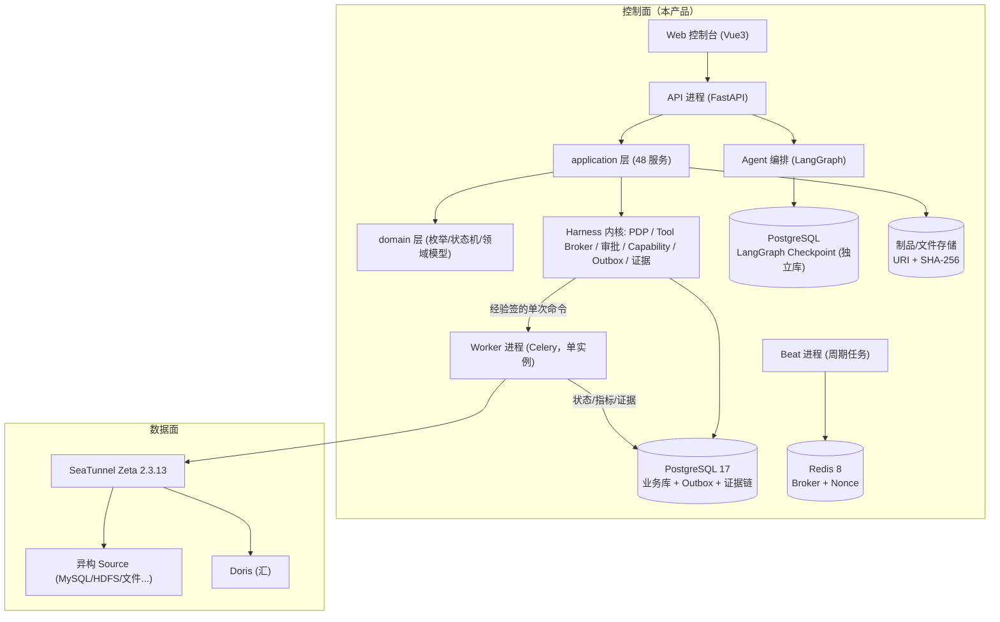
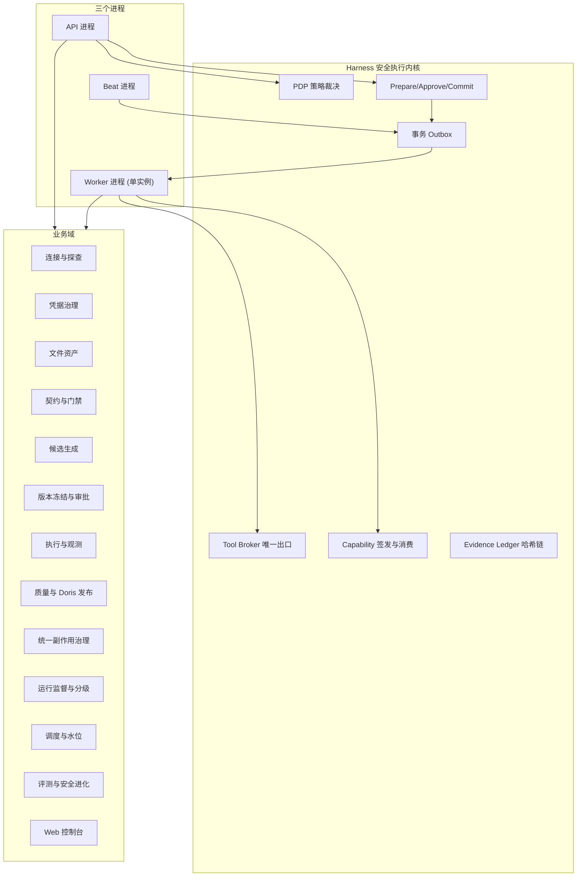
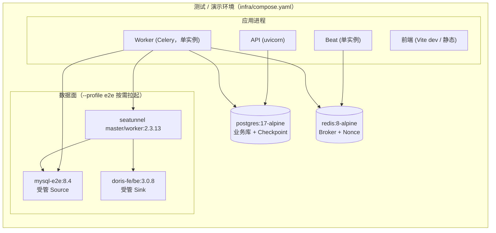
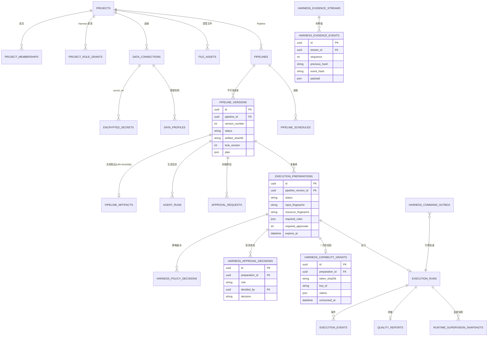
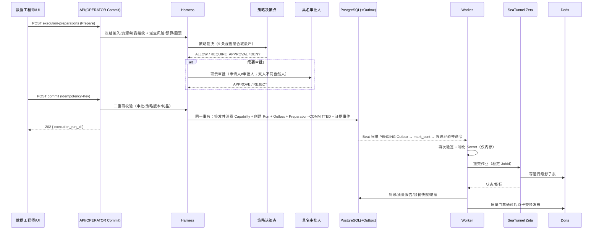
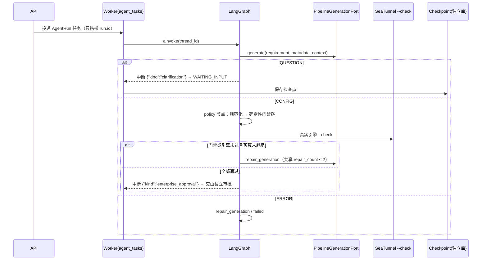

# 《etl_agent》技术设计规格说明书（Design Spec）

> | 文档名称 | 技术设计规格说明书 |
> |----------|-------------------|
> | 版本 | v1.2 |
> | 架构师角色 | 系统架构师 |
> | 日期 | 2026-10-14 |
> | 状态 | 评审稿（已按参考实现与评审意见核对） |
> | 依据 PRD | `docs/prd.md` v1.2 |
> | 环境范围 | **测试 / 演示环境；暂不考虑生产环境** |
> | 事实校验来源 | 参考实现 `../etl_agent`：`main.py`、`worker.py`、`agent/graph.py`、`domain/*`、`application/*`（48 个服务）、`infrastructure/models.py`（41 张表）、`infrastructure/{harness_signing,harness_runtime,seatunnel/*,*_probe}.py`、`config.py`、`infra/compose.yaml` |

**设计目标一句话**：把 PRD 的"要什么"翻译成"怎么做"——用**模块化单体的控制面**承载需求理解、制品治理与执行授权，用**独立的数据面引擎**搬运数据，并保证**所有副作用只经过同一个 Harness 入口**。

**阅读约定**：本文所有架构事实均来自参考实现 `../etl_agent`，可直接作为开发契约；凡属"建议/待明确"的均已显式标注，不代表当前实现。

**环境口径（本轮确认）**：本期**仅面向测试 / 演示环境，暂不考虑生产环境**。因此部署形态、HA、企业 KMS/HSM（**本期明确不使用**）、多租户与配额等生产专属设计**均不在本设计范围**；凡标注"生产阶段适用"的内容保留为设计不变量，本期不实现、不验收。并发**只需测试环境可用，单 Worker 即可**。

---

## 1. 架构设计概述

### 1.1 架构风格

**前后端分离 + 控制面 / 数据面分离 + 模块化单体（分层）+ 异步三进程 + 事件驱动（Outbox）**

| 维度 | 选择 |
|---|---|
| 前后端 | **前后端分离**：前端 Vue 3 + TS + Vite（`frontend/`）经 `/api/v1` JSON API 访问后端；前端不保存任何权威状态 |
| 进程风格 | 模块化单体，拆成 **API / Worker / Beat** 三个独立进程（同一代码库、同一数据库） |
| 分层 | `api`（FastAPI 路由）→ `application`（48 个应用服务）→ `domain`（纯领域：枚举/状态机/模型）；`infrastructure` 实现端口 |
| Agent 编排 | LangGraph 状态图（六节点），Checkpoint 使用**独立数据库** |
| 可靠性 | 事务 Outbox + 幂等键 + 一次性 Capability + 证据哈希链 |
| 数据面 | 独立进程外引擎 Apache SeaTunnel Zeta（控制面通过 REST 提交已物化制品） |
| 运行环境 | **测试 / 演示（Compose）**；生产形态不在本期范围 |



### 1.2 选型理由与权衡

- **为什么是模块化单体而非微服务**：产品第一版是**单团队 / 单层项目模型**（PRD Q1 已确认），无租户与配额；核心安全价值来自"**所有副作用经过同一个 Harness 入口**"。拆成微服务会把"统一授权入口"变成"跨服务调用 + 分布式事务"，直接削弱最关键的不变量。单体+三进程用**同一数据库事务**换来了 Outbox 原子性与证据链一致性。
- **为什么控制面与数据面分离**：数据搬运交给 SeaTunnel Zeta，控制面只做"授权前/授权后"的治理，避免重造引擎。
- **为什么本期不做多 Worker / 队列编排**：本期只要求**测试环境可用**，单 Worker 足够；不引入队列隔离、优先级、项目级并发上限，保持实现最简单（后续生产阶段再评估）。
- **为什么引入 LangGraph**：把"一次模型调用"变成显式、可恢复、有预算上限的状态机（澄清中断 / 有限修复 / 审批中断），Checkpoint 独立库避免与业务事务耦合。

---

## 2. 技术栈与依赖

| 层 | 技术选型 | 用途 |
|----|---------|------|
| 语言/工具链 | Python `>=3.12,<3.13`、uv（锁文件）、hatchling、Ruff、Mypy（strict）、Pytest | 运行时与质量门禁 |
| 控制面 API | FastAPI `>=0.116,<1` + uvicorn `>=0.35,<1` | 18 个路由模块；异常→HTTP 映射 |
| 业务存储 | PostgreSQL 17（SQLAlchemy 2 async + asyncpg；Alembic 迁移，单一 head） | 业务事实真相源 |
| 消息/调度 | Redis 8 + Celery 5（Worker + Beat，**单 Worker**） | 异步任务与周期扫描 |
| Agent 编排 | LangGraph `>=0.6,<2` + `langgraph-checkpoint-postgres`（**独立库**） | 六节点生成状态机 |
| 密码学 | `cryptography`（Fernet 主密钥；Ed25519 签名/验签，**密钥来自文件/注入，不用 KMS/HSM**） | 秘密加密与 Capability/证据签名 |
| 可观测 | OpenTelemetry（OTLP/HTTP，**默认关闭**）+ structlog | 链路追踪与结构化日志 |
| 前端 | Vue 3 + TypeScript + Vite（`vue-tsc -b && vite build`） | 五视图控制台（**单文件，不拆分**） |
| 数据面 | Apache SeaTunnel Zeta 2.3.13（镜像 `apache/seatunnel:2.3.13`） | 连接器与分布式搬运 |
| 连接器驱动 | PyMySQL / asyncpg / oracledb / python-tds / PyHive / WebHDFS(httpx) / pyarrow / pyorc / openpyxl / pypdf / defusedxml | 探查与文件解析 |

**第三方依赖（区分既定与本次引入）**：

| 依赖 | 类别 | 用途 | 本期口径 |
|---|---|---|---|
| `seatunnel-cli[openai]` | 可选 | 官方 CLI 黑盒生成后端（固定 commit `2b060343dcc99c58fe53ebede9e8b6886e19bfeb`） | 默认路径为 `direct`，CLI 为可选 |
| Vault KV v2 | 外部 | 凭据存储（`secret_factory` 可路由） | 可选；本地默认 `fernet-db` |
| **企业 KMS/HSM** | 外部 | 私钥托管 | **本期不使用**（密钥用文件/注入式 Ed25519） |
| 可信身份网关 | 外部 | 生产身份签名（HMAC + Nonce + 时间戳） | **本期不涉及**（生产阶段适用） |

**数据库安排（严格按模版代码 `../etl_agent`）**：本项目是"**PostgreSQL 作控制面存储 + MySQL 作受管数据源**"的组合，二者职责不同、不可互换。

| 数据库 | 角色 | 连接与配置 | 说明 |
|---|---|---|---|
| **PostgreSQL 17** | **控制面业务库**（应用存储） | `ETL_AGENT_DATABASE_URL=postgresql+asyncpg://…`；SQLAlchemy 2 async + asyncpg；Alembic 迁移（单一 head） | 保存项目/版本/审批/执行/证据等全部企业事实；**应用进程只连它作为存储** |
| **PostgreSQL 17（独立库）** | **LangGraph Checkpoint 库** | `ETL_AGENT_CHECKPOINT_DATABASE_URL=postgresql://…`（`langgraph-checkpoint-postgres`） | 与业务库**分库**；应用启动不自动建表，部署阶段显式 setup |
| **MySQL 8.4** | **受管数据源（Source）** | 演示实例 `localhost:3308`，账号 `atguigu` / `@Atguigu.123`；`ConnectorType.MYSQL`，驱动 PyMySQL | **不是应用存储**：仅作为被探查 / 被同步的数据源；`pyproject.toml` 的应用存储驱动只有 `asyncpg` |
| **Doris 3.0.8** | **受管数据源（Sink）** | 经 MySQL 协议 `9030` 访问（`pymysql`） | 目标库；原子发布走影子表 + Swap |
| **Redis 8** | 消息与缓存 | `ETL_AGENT_REDIS_URL=redis://…` | Celery broker/backend + 网关 Nonce 一次性消费 |

> 澄清：`prompt/spec.prompt` 里的 `数据库：MySQL 8.4` 指**受管数据源实例**（教学/演示环境的那台 MySQL），**控制面应用存储仍为 PostgreSQL 17**——与模版代码一致（`config.py` 的 `database_url` 为 `postgresql+asyncpg`，`pymysql` 仅用于数据源探查）。

---

## 3. 模块 / 服务划分



| 模块 / 服务 | 职责边界（做什么 / **不做什么**） |
|---|---|
| **API 进程** | 注册全部路由（`/health` 无身份，其余挂 `/api/v1`）；领域异常映射为稳定 HTTP 码并附 `trace_id`。**不执行长耗时外部调用；不持有执行引擎凭据** |
| **Worker 进程（单实例）** | 消费全部异步任务：连接测试/探查、Agent 生成、执行提交与监控、回滚/清理、Secret 治理、文件解析、调度、Outbox 投递、心跳。**只有 Worker 拥有读取 Secret 与访问 SeaTunnel 的权限** |
| **Beat 进程** | 周期投递 4 类扫描：Worker 心跳(10s)、凭据到期扫描(3600s)、调度扫描(30s)、Outbox 扫描(2s)。**只投递不执行** |
| **Harness 安全执行内核** | PDP 裁决、Tool Broker 唯一执行出口、`prepare→approve→commit`、一次性 Capability、事务 Outbox、证据哈希链。**不解释业务语义、不生成候选** |
| **Agent 编排（LangGraph）** | 六节点：`generate / clarify / repair_generation / policy / wait_for_review / failed`；共享修复预算。**只能把候选意图交给 Harness，不能直达 SeaTunnel** |
| **候选生成** | 应用层只依赖 `PipelineGenerationPort`；`direct`（默认）与 `seatunnel-cli`（可选）双路径；就绪检查返回 `READY/NOT_CONFIGURED`。**不接触凭据明文、不做最终裁决** |
| **连接与探查** | 登记连接、异步连通性测试、表级探查、脱敏样本、标识符白名单。**Adapter 内完成脱敏；不下发无界全表 COUNT；不把密码交给模型** |
| **凭据治理** | 双后端 Provider、轮换/回退/迁移/销毁、到期告警与 Webhook。**凭据只在 Worker 调 Adapter 前短暂存在于内存** |
| **契约与门禁** | Schema/质量/增量/交付契约、dry-run、design_review、制品摘要绑定。**不做 SQL 等价性证明；不把模型自报的 dry-run 当审批证据** |
| **版本冻结与审批** | `Pipeline/PipelineVersion/Artifact/ApprovalRequest` 职责分离、内容寻址摘要、四眼审批。**已冻结制品不原地编辑** |
| **执行与观测** | 唯一创建路径、稳定 JobId、状态映射、指标归一化、确定性失败分类。**迟到错误不改写终态** |
| **质量与 Doris 发布** | 单次读取双路隔离、质量报告、运行级影子表、原子交换。**引擎退出码为 0 不等于质量通过** |
| **统一副作用治理** | 9 类副作用的通用 Harness（两层职责 + 封闭性约束 + 租约 + 双重证明）。**未三处同时注册的操作不可执行** |
| **运行监督与数据分级** | 六维预算、六条确定性规则、只减权动作、分级传播。**不访问数据源；不扩权；THROTTLE 只降观测频率** |
| **调度与水位** | cron 调度、切换版本重置水位、`(lower, upper]` 窗口。**调度只创建 Preparation，不直接执行** |
| **评测与安全进化** | L0/L1/L2 仿真、六项冻结门槛、受控进化候选。**候选不是可执行代码；推广只是签名授权** |
| **Web 控制台** | 五视图可视化；真相源始终是 PostgreSQL。**本期保持单文件实现、不拆分、不多语言/无障碍；浏览器不保存制品/审批/令牌/运行状态** |

### 3.1 探查适配器矩阵（Connector ↔ Adapter ↔ 默认端口）

每个 `ConnectorType` 对应一个元数据探查 Adapter，统一实现 `MetadataProbePort`（`test_connection` / `profile_table`），由 `ProbeRegistry` 按类型分派：

| Connector | Adapter / 协议 | 默认端口 | 说明 |
|---|---|---|---|
| **MySQL** | `PyMySQL` | 3306 | **本章主线** |
| **Doris** | MySQL FE 协议（复用 MySQL Adapter） | 9030 | 用于元数据与管理查询 |
| **PostgreSQL** | `asyncpg` | 5432 | 独立 Adapter |
| **Oracle** | `python-oracledb`（Thin 模式） | 1521 | 独立 Adapter |
| **SQL Server** | `python-tds`(pytds) | 1433 | 独立 Adapter |
| **Hive** | `PyHive`/Thrift | 10000 | 查询元数据，**不替代 HDFS** |
| **HDFS** | WebHDFS(`httpx`) | 9870 | 使用**受限路径与显式重定向规则** |

**实现约定（来自模版代码，开发需遵循）**：

- **注册即契约**：`ProbeRegistry` 显式注册 7 类；未注册类型 `get()` 抛 `DomainError`（`LOCAL_FILE` 不走探查，走受管文件链路）。
- **连接隔离**：每个 Adapter 只有 `_connect()` 一处触碰网络，其余逻辑（SQL 拼装、类型映射、主键提取、脱敏、`close`）可单测替换 —— 这是刻意设计的可测点。
- **同步驱动包装**：`Oracle/SQL Server/Hive` 为同步驱动，统一用 `asyncio.to_thread` 包装；`PostgreSQL` 用 `asyncpg`、`HDFS` 用 `httpx`，均为原生异步。
- **脱敏在 Adapter 内完成**：返回控制面前即对样本做字段级脱敏（密码→`[REDACTED]`、邮箱→`a***@domain`、手机号→`前3****后4`），不允许"返回原始样本等上层脱敏"。
- **标识符白名单**：对象名匹配 `^[A-Za-z_][A-Za-z0-9_$]{0,127}$`；越界即拒绝，数据库不会收到该字符串构造的查询。
- **HDFS 安全**：仅 simple 认证（Kerberos 显式拒绝）、仅 CSV/JSON/JSONL/Parquet/ORC、拒绝混合目录、DataNode 重定向必须在显式 `authority` 白名单内。
- **不执行无界全表 `COUNT`**：统计只取估算值（`reltuples` / `sys.partitions` / `DESCRIBE FORMATTED` 等），缺失时降级为空而不让基础探查失败。

---

## 4. 部署拓扑

**本期只交付测试 / 演示环境（Compose）；生产形态不在本期范围。**



**环境口径**：

| 环境 | 本期是否交付 | 说明 |
|---|---|---|
| dev / local | ✅ | Compose 常驻 PostgreSQL + Redis；MySQL/Doris/SeaTunnel 走 `e2e` profile；`dev-header` 身份；`fernet-db` 秘密后端；OTLP 默认关闭 |
| test | ✅ | 同 dev（隔离库），跑 L0/L1 与冻结 Benchmark |
| staging / prod | ❌ **本期不考虑** | 生产身份（可信网关）、KMS/HSM、多副本 HA、对象存储/WORM、K8s 编排等均**不在本期范围**，留待后续阶段 |

---

## 5. 数据模型（ER）

数据层共 **41 张业务表**（不含 Alembic 版本表），按域分组：

| 分组 | 表 |
|---|---|
| 身份/项目 | `users`、`projects`、`project_memberships`、`project_role_grants` |
| 连接/密钥 | `data_connections`、`encrypted_secrets`、`secret_migration_requests`、`secret_rotation_requests`、`secret_rotation_rollback_requests`、`secret_destruction_requests`、`credential_expiry_alerts`、`credential_alert_deliveries` |
| 文件/探查 | `data_profiles`、`file_assets` |
| 契约/生成 | `pipelines`、`pipeline_versions`、`pipeline_artifacts`、`agent_runs`、`pipeline_schedules` |
| 审批/执行 | `approval_requests`、`execution_runs`、`execution_events`、`quality_reports`、`runtime_supervision_snapshots`、`rollback_requests`、`rollback_cleanup_requests`、`worker_heartbeats` |
| Harness 内核 | `harness_policy_decisions`、`execution_preparations`、`harness_approval_decisions`、`harness_capability_grants`、`harness_side_effect_preparations`、`harness_side_effect_approvals`、`harness_side_effect_capability_grants`、`harness_command_outbox`、`harness_evidence_streams`、`harness_evidence_events` |
| 评测/治理 | `audit_events`、`benchmark_runs`、`safety_improvement_proposals`、`safety_releases` |



**关键约束（可直接建表）**：

| 表 | 关键约束 |
|---|---|
| `pipeline_versions` | `UNIQUE(pipeline_id, version_number)`；`lock_version` 乐观并发 |
| `agent_runs` | `thread_id` 唯一 |
| `execution_runs` | `harness_preparation_id` 唯一；`idempotency_key` 唯一 |
| `execution_preparations` | `UNIQUE(project_id, idempotency_key)` |
| `harness_approval_decisions` | `UNIQUE(preparation_id, role)`、`UNIQUE(preparation_id, decided_by)` |
| `harness_capability_grants` | 只存 `token_sha256`，不存可重放明文 |
| `harness_command_outbox` | `UNIQUE(command_type, aggregate_id)` |
| `harness_evidence_events` | `UNIQUE(stream_id, sequence)`；`event_hash` 全局唯一 |

**核心状态机**：`PIPELINE_TRANSITIONS`（`DRAFT→PROFILING→GENERATED→VALIDATED→WAITING_APPROVAL→{APPROVED,REJECTED}`）、`AGENT_RUN_TRANSITIONS`、`EXECUTION_TRANSITIONS`（三者终态不可重启，见 PRD §8）。

---

## 6. 关键接口定义

统一前缀 `/api/v1`；**只有 `GET /health` 无前缀、无身份**。身份头：`X-Actor-ID`（本地）或可信网关签名四件套（生产阶段）；链路 `X-Trace-ID`；幂等 `Idempotency-Key`（8–128 字符，Preparation/重跑必需）。

| 编号 | 方法 | 路径 | 说明 |
|------|------|------|------|
| API-01 | POST | `/api/v1/projects/bootstrap` | 一次性初始化（成功后永久 409） |
| API-02 | POST | `/api/v1/connections` → `/connections/{id}/tests|profiles` | 登记连接、异步测试与探查（202） |
| API-03 | POST | `/api/v1/pipelines/versions/{id}/generation` | 启动候选生成（投递 AgentRun，202） |
| API-04 | POST | `/api/v1/pipeline-versions/{id}/approval-requests` → `/approval-requests/{id}/decisions` | 版本四眼审批 |
| API-05 | POST | `/api/v1/pipeline-versions/{id}/execution-preparations` | Prepare（冻结事实，无副作用，201） |
| API-06 | POST | `/api/v1/execution-preparations/{id}/decisions` | 具名职责审批 |
| API-07 | POST | `/api/v1/execution-preparations/{id}/commit` | Commit（仅 OPERATOR，202，创建 Run+Outbox） |
| API-08 | GET | `/api/v1/execution-runs/{id}`（`/events`、`/supervision-snapshots`、`/quality-report`） | 执行台账与观测 |

**OpenAPI 片段（API-07 Commit）**：

```yaml
post:
  summary: 提交执行（仅 OPERATOR）
  parameters:
    - name: Idempotency-Key
      in: header
      required: true
      schema: { type: string, minLength: 8, maxLength: 128 }
  responses:
    '202':
      description: 授权已验证并消费，Run 与 Outbox 已原子创建
      content:
        application/json:
          schema:
            type: object
            properties:
              execution_run_id: { type: string, format: uuid }
              status: { type: string, enum: [QUEUED, SUBMITTED] }
    '403': { description: PermissionDenied（非 OPERATOR / 自批） }
    '404': { description: ResourceNotFound }
    '409': { description: VersionConflict（审批未满足 / 制品变化 / 已提交） }
    '503': { description: ExternalServiceUnavailable }
```

**错误码体系（诚实说明）**：当前实现**不使用自定义业务错误码**，而是把领域异常类型映射为稳定 HTTP 状态码，并在响应体附 `trace_id`：

| 领域异常 | HTTP | 典型场景 |
|---|---|---|
| `PermissionDenied` | **403** | 自批、职责不足、非 OPERATOR Commit |
| `ResourceNotFound` | **404** | 资源不存在 |
| `VersionConflict` | **409** | 审批未满足、制品摘要变化、Bootstrap 重复、清理未到期 |
| `ExternalServiceUnavailable` | **503** | Redis 不可用（禁止降级为可重放模式）、引擎不可用 |
| 其余 `DomainError` | **400** | 参数/契约/状态校验失败 |

响应结构：`{ "detail": "<领域消息>", "trace_id": "<可选>" }`。前端**不得根据错误文本猜状态迁移**。

---

## 7. 关键流程时序图

### 7.1 受管执行：prepare → approve → commit → Outbox → Worker → Doris



### 7.2 候选生成：LangGraph 六节点 + 共享修复预算



---

## 8. 非功能设计

> 原则：**每个 PRD 指标都要落到具体设计手段，不复述指标**。

| 维度 | 指标（来自 PRD） | 设计手段 |
|------|----------------|---------|
| 安全 | 秘密不落明文 = 0 | Secret 只在 Worker 内存短暂存在；`SecretProvider` 只存引用/密文；审计/日志/MQ/证据/Prompt 均白名单化；错误经 `redact_error` 清洗后截断 |
| 安全 | 失败关闭 | 策略/审批/签名/证据无法验证时抛 `DomainError` 中断；PDP `DENY` 清空审批要求 |
| 安全 | 破坏性双人 | PDP 硬编码 `DATA_APPROVER + SECURITY_APPROVER`；DB 两个 `UNIQUE` 兜底；应用层 `same_person` 校验 |
| 安全（生产阶段适用） | 生产身份可信 | `trusted-gateway`（HMAC + Nonce）**本期不涉及**，保留为设计不变量 |
| 性能 | 非 LLM P95 退化 ≤20% | 确定性路径纯内存计算；策略/门禁无网络；基准 `non_llm_p95_ms=20` 冻结回归 |
| 性能 | 生成调用 ≤3 份 | 共享 `repair_count`（首份+最多 2 次修复）；单份一次调用、硬超时 |
| 性能 | 监控不占线程 | 监控用**自调度**（2s/节流 5s）重排队，不长期占用 Worker 线程 |
| 容量 | 预算不可扩权 | `RuntimeBudget` 仅允许**收紧**平台上限；每维有绝对上界 |
| 可用性 | 崩溃可恢复 | 事务 Outbox + 幂等键 + 租约；Worker `acks_late` + 单次预取 + `reject_on_worker_lost`；Outbox 认领 `FOR UPDATE SKIP LOCKED` |
| 可用性 | 不重复副作用 | 一次性 Capability + Replay Guard 原子消费 + 稳定 JobId 认领；重复消息收敛为业务上一次效果 |
| 可用性 | 迟到错误不改终态 | `mark_failed` 对已终态直接返回；取消只有引擎确认 `CANCELED` 才进入 `CANCELLED` |
| 并发（本期） | 测试环境可用 | **单 Worker**；不引入队列隔离、优先级、项目级并发上限 |
| 可观测 | 全链路 Trace | `configure_observability` 挂 FastAPI / Celery / SQLAlchemy / httpx 埋点；同一 Trace 贯穿三进程；OTLP 默认关闭 |
| 可观测 | 脱敏采集 | 不采集请求体、SQL 绑定参数、业务样本、HOCON、Prompt、Secret、错误原文 |
| 可观测 | 证据可审计 | Evidence Ledger 哈希链 + 关键事件 Ed25519 检查点；验证器**只报告不修复** |
| 可维护 | 类型与门禁 | Mypy strict + Ruff + Pytest；L0/L1 每次提交、L2 独立工作流 |

---

## 9. 设计决策记录（ADR）

| 编号 | 决策 | 背景 / 选项 | 选择理由 | 后果 |
|------|------|------------|---------|------|
| ADR-01 | **控制面用模块化单体 + 三进程，而非微服务** | A 微服务；B 模块化单体 | 单团队/单层项目；核心不变量是"所有副作用同一入口"，拆服务会把统一授权变成跨服务分布式事务 | 放弃独立扩缩容与物理隔离；用进程拆分 + 权限最小化弥补 |
| ADR-02 | **所有副作用经统一 Harness（Prepare→Approve→Commit + 一次性 Capability + Outbox）** | A 直接调引擎；B 统一内核 | 单向 HTTP 请求无法回答"审批后内容是否变化/策略是否更新/是否重放" | 增加一次 Prepare/Commit 往返；换来可验证授权与证据链 |
| ADR-03 | **LangGraph Checkpoint 用独立数据库** | A 复用业务库；B 独立库 | 图状态与业务事实职责分离；避免图恢复与业务事务耦合 | 多一个库与一次部署期建表（应用启动不自动建表） |
| ADR-04 | **数据搬运交 SeaTunnel Zeta，控制面不实现引擎** | A 自研搬运；B 复用 SeaTunnel | 不重造连接器与分布式执行；控制面专注治理 | 锁定引擎版本 2.3.13；引擎能力边界即产品能力边界 |
| ADR-05 | **秘密后端与生成后端都做成可插拔端口** | A 绑定单一实现；B 端口化 | 迁移期需要 `fernet-db`/`vault-kv-v2` 并存；生成需要 `direct`/`seatunnel-cli` 可切换且**不改变安全边界** | 增加抽象层与路由复杂度；换来可迁移与供应商中立 |
| ADR-06 | **审批绑定内容摘要而非数据库 ID** | A 绑定版本 ID；B 绑定 plan+HOCON 摘要 | 防止"审批的内容"与"执行的内容"不一致；读取审查视图时重算比对 | 任何修改都必须产生新版本与重新审批 |
| ADR-07 | **控制面存储用 PostgreSQL，MySQL 仅作受管数据源** | A 用 MySQL 作应用库；B PostgreSQL 作应用库 + MySQL 作数据源 | 事务、`FOR UPDATE SKIP LOCKED`、JSONB、Bootstrap 的 `pg_advisory_lock`、`langgraph-checkpoint-postgres` 均按 PostgreSQL 实现；MySQL/Doris 是**被治理对象**而非平台自身存储 | 应用存储驱动锁定 `asyncpg`；MySQL 能力（含 Doris 的 MySQL 协议）作为数据源纳管 |
| ADR-08 | **本期单 Worker、不引入 KMS/HSM** | A 一开始就上多 Worker 与 KMS/HSM；B 单 Worker + 文件密钥 | 本期只要求测试/演示环境可用，追求实现最简单；签名密钥用文件/注入式 Ed25519 已满足安全不变量 | 后续生产阶段需再评估多 Worker 队列编排与 KMS/HSM 接入 |

---

## 10. 任务分解清单

> 依赖列中的编号表示必须先完成；未标注者可与同层并行。顺序与 PRD 里程碑一致。

| 任务编号 | 模块 | 依赖 | 说明 |
|---------|------|------|------|
| T-01 | 工程底座 | — | `config.py` 环境配置、数据库/Alembic 单一 head、健康检查、领域异常→HTTP 映射 |
| T-02 | 领域层 | T-01 | `domain/enums.py`、`state_machine.py`、`harness.py`、`supervision.py`、`side_effects.py`、`errors.py` |
| T-03 | 身份与项目 | T-02 | Bootstrap 一次性、成员/职责授予、`dev-header` 身份模式、Nonce 存储 |
| T-04 | 连接与探查 | T-03 | `probe_registry` + 7 类探针、异步测试/探查、Adapter 内脱敏、标识符白名单 |
| T-05 | 凭据治理 | T-04 | `secret_factory`（Fernet/Vault）、轮换/回退/迁移/销毁、到期告警与 Webhook |
| T-06 | 文件资产 | T-03 | 流式上传、原子落盘、九格式解析、规范化为受管 Source |
| T-07 | 契约与门禁 | T-02 | `schema_contract/quality/incremental/delivery/design_review`、`policy` 静态检查 |
| T-08 | 候选生成 | T-07 | `generation` 端口、`direct` 适配器、`generation_readiness` |
| T-09 | Agent 编排 | T-08 | `agent/graph.py` 六节点、独立 Checkpoint、`agent_tasks` |
| T-10 | 版本冻结与审批 | T-07 | `pipelines`（冻结/摘要/血缘）、`approvals` 四眼 |
| T-11 | **Harness 内核** | T-02, T-10 | `harness_policy`（PDP 9 规则）、`tool_broker`、`execution_harness`、`harness_signing`、`harness_runtime`、`evidence_ledger`、`harness_outbox` + `harness_outbox_tasks` |
| T-12 | 执行与观测 | T-11 | `execution`、`execution_metrics`、`execution_diagnostics`、`tasks`（提交/监控/自调度） |
| T-13 | 质量与 Doris 发布 | T-12 | `quality`、`doris_publish`（影子表 + 原子交换 + 回滚/清理） |
| T-14 | 统一副作用治理 | T-11 | `side_effect_harness`、`side_effect_coordination`、`side_effect_runtime` + 各 `*_tasks`（含租约/双重证明） |
| T-15 | 运行监督与数据分级 | T-12 | `runtime_supervision`（6 规则 + 预算）、`data_classification` |
| T-16 | 调度与水位 | T-12 | `schedules` + `schedule_tasks`、水位 `(lower,upper]`、切换版本重置水位 |
| T-17 | 评测与安全进化 | T-11, T-15 | `benchmark` + `benchmark_cli`、`safety_evolution`、冻结场景与六项门槛 |
| T-18 | Web 控制台 | T-04..T-17 | 五视图；**本期保持单文件实现（不拆分、不多语言）**，不做组件化重构 |
| T-19 | 可观测与 Worker/Beat 装配 | T-01 | `observability` 埋点、`worker.py`（acks_late/预取/心跳、**单 Worker**）、Beat 4 类周期任务 |

**并行建议**：T-04/T-05/T-06 可并行；T-07/T-08/T-09/T-10 可并行；T-11 是收敛点，须先于 T-12/T-14/T-17。

---

## 11. 设计层面结论

> 说明：以下为**本轮评审**对设计层面事项的确认，与 PRD 第 11 章一致；无依据的生产阶段事项统一归入"后续阶段"。

### 11.1 本轮已明确

| 编号 | 结论 | 影响 |
|---|---|---|
| DF-1 | **本期不考虑生产环境** | 部署只交付 Compose（dev/test）；HA / K8s / 多副本不在设计范围（§4） |
| DF-2 | **本期不使用 KMS/HSM** | 签名密钥用文件/注入式 Ed25519；不引入 KMS/HSM 适配（§2、§9 ADR-08） |
| DF-3 | **并发：测试环境单 Worker 即可** | 不设多 Worker、不做队列隔离 / 优先级 / 并发上限（§3、§8） |
| DF-4 | **连接器范围纳入** | PostgreSQL / Oracle / SQL Server / Hive / HDFS 与 MySQL/Doris/本地文件同为受管连接器（§3.1） |
| DF-5 | **保留参数不做差异化** | Doris 回滚 7 天、Secret 回退 7 天沿用全局配置，不加项目/数据类型维度 |
| DF-6 | **前端不拆分、不多语言** | 控制台本期保持单文件实现，不做组件化重构与 i18n / 无障碍 |

### 11.2 待定（后续阶段）

| 编号 | 问题 | 建议确认方 |
|------|------|-----------|
| OQ-1 | 若未来启用逐行 LLM，模型供应商白名单与允许外发的字段分级上限是什么？ | 安全 + 合规 |
| OQ-2 | SeaTunnel 版本治理：长期锁定 2.3.13 与 CLI commit 的升级窗口与回归责任（**生产阶段适用**） | 架构 |
| OQ-3 | 生产阶段的部署形态（K8s/多可用区/HA）、是否引入 KMS/HSM 与证据 WORM、企业部署系统对接 | 架构 + 运维 + 安全 |

---

*文档结束。本设计规格的所有模块边界、数据表、接口与错误映射均可回溯到参考实现 `../etl_agent` 的具体文件；所依据的需求见 `docs/prd.md` v1.2。*
