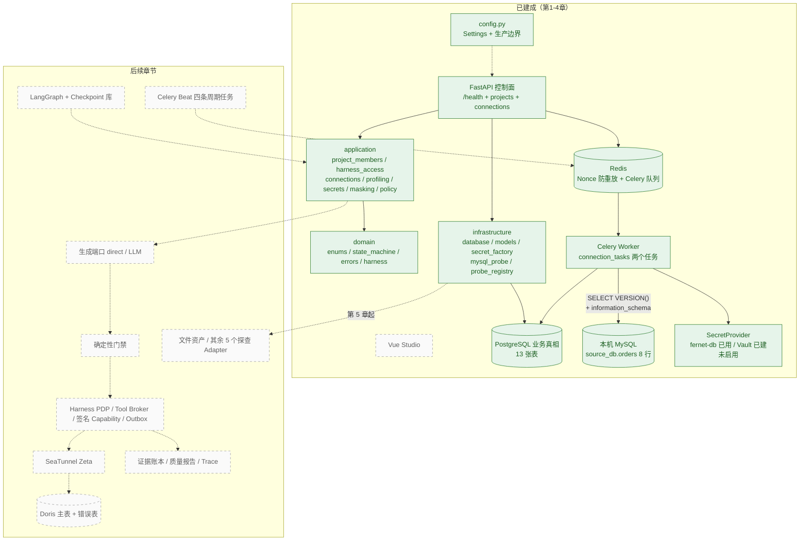
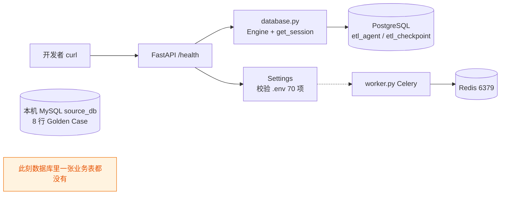
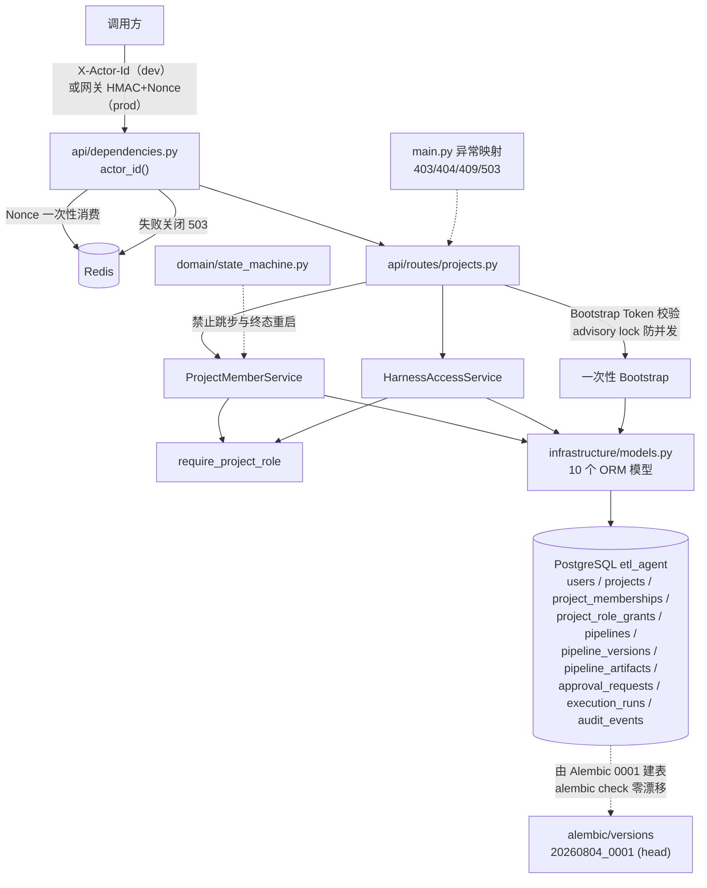
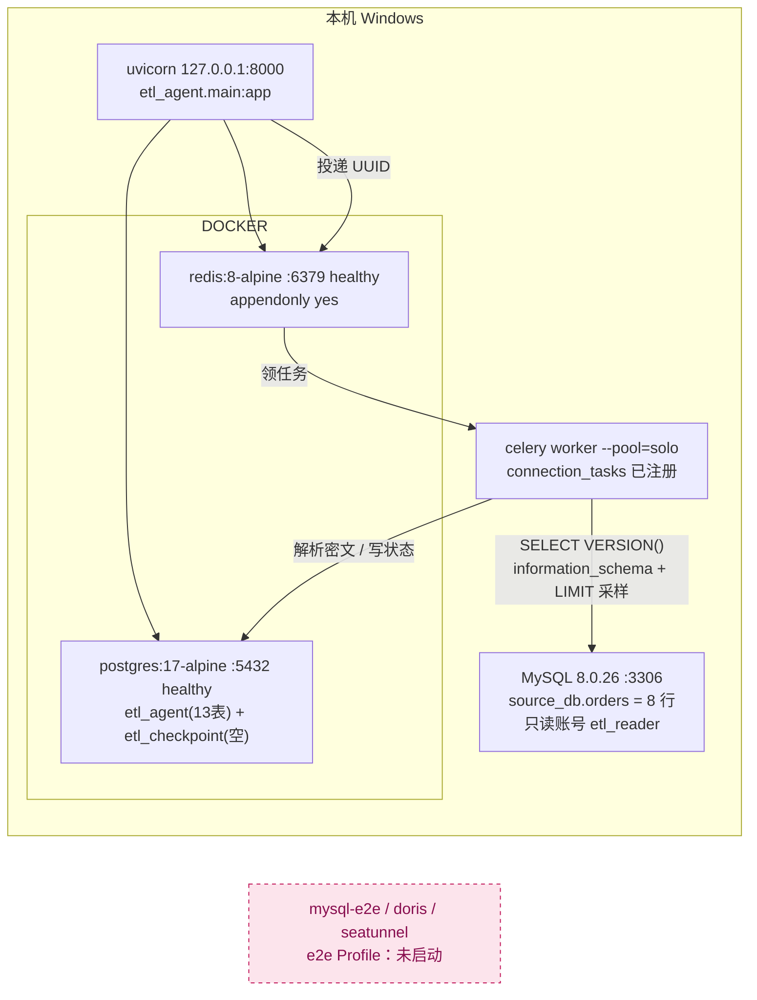
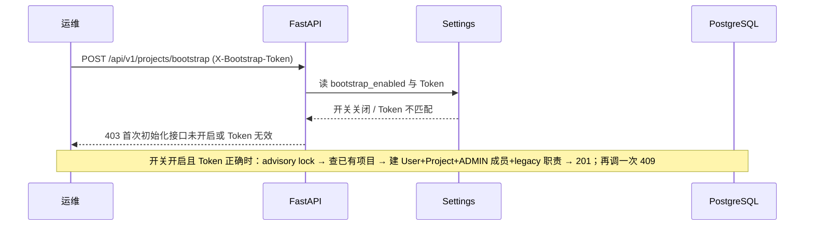

# 实现步骤说明与逐步架构图

> 工作项目 `etl_agent_demo`。截至 2026-10-14：第 1、2、3、4 章已落地并实测通过。
> 图中实线 = 已存在且已验证；虚线 = 课件规划但尚未到章节，明确不建。

---

## 一、每一步在做什么（按实际执行顺序）

### 第 1 章：把问题钉死

| 步 | 动作 | 产出 | 为什么要这一步 |
|---|---|---|---|
| 1.1 | 从 §1.2 提取 MySQL 初始化脚本 | 8 行固定教学数据（1001–1008） | 后面所有"清洗对不对"都要有可比对的基准，不能靠口头描述 |
| 1.2 | 本机建 `source_db.orders` 并灌数 | 8 行数据 | 提供真实可查的 Source，而不是假设 |
| 1.3 | 按清洗契约复核 Golden Case | 有效 4 / 拒绝 1+1+2 / 去空格 / 邮箱脱敏 | 把"提高数据质量"变成逐条可判的规则，验收才有客观依据 |

### 第 2 章：搭工程底座

| 步 | 动作 | 产出 | 为什么要这一步 |
|---|---|---|---|
| 2.1 | `config.py` 配置入口 | 70 项 `ETL_AGENT_*` + 启动期生产边界校验 | 危险配置组合必须在启动时失败，不能等跑到第 11 章才炸 |
| 2.2 | 修复秘密泄漏 | `ConfigurationError` 脱敏消息 | 校验失败的日志原本会把 HMAC 密钥原文打出来 |
| 2.3 | `main.py` + `/health` | 四字段就绪探针 | 给服务一个"活着吗、配置齐了吗"的窗口，且不读秘密 |
| 2.4 | `infrastructure/database.py` | 异步 Engine + `get_session()` | 固定"一次请求一个会话、不自动提交"的边界 |
| 2.5 | `worker.py` | Celery 装配（JSON / acks_late / prefetch=1） | 慢任务与 API 分进程，故障才能被区分 |
| 2.6 | Compose 起 postgres + redis；核对 `postgres-init.sql` | 两库分账号 + 两个 DSN 连通 | 业务真相与会话恢复物理隔离 |
| 2.7 | 填 Fernet 主密钥、建 `var/` 三目录 | `.env` 就绪 | fernet-db 模式没主密钥就永远 configured=false |

### 第 3 章：写入企业事实

| 步 | 动作 | 产出 | 为什么要这一步 |
|---|---|---|---|
| 3.1 | `domain/enums.py`、`harness.py::HarnessRole` | 28 个枚举 + 5 个职责 | 状态必须是固定词汇，否则 API/库/Worker 各写一套 |
| 3.2 | `domain/errors.py` | `DomainError` + 5 个子类 | 课件从未给这份清单，但十条验收场景全靠这些异常名 |
| 3.3 | `infrastructure/models.py` | 10 个 ORM 模型 | 版本、审批、执行、审计第一次有了持久化形状 |
| 3.4 | `alembic/versions/20260804_0001_initial.py` + `upgrade head` | 库里 10 张业务表 | 结构变更必须有版本号和回滚，不能靠启动时 `create_all` |
| 3.5 | `domain/state_machine.py` | 显式迁移表 + 4 个校验函数 | 枚举只说"有哪些值"，不说明"值之间怎样变化" |
| 3.6 | `api/dependencies.py` | dev-header 与可信网关 HMAC + Redis Nonce | 生产不能信裸请求头；Redis 挂了就 503，不许降级放行 |
| 3.7 | `application/profiling.py`（只放 `require_project_role`）+ `harness_access.py` + `project_members.py` | 项目角色与服务端权限判断 | 越权必须在服务端被拒，不能靠前端藏按钮 |
| 3.8 | `api/routes/projects.py` + `api/schemas.py` | bootstrap / members / harness-roles 三个端点 | 一次性 Bootstrap 建首位管理员，之后才能授权别人 |
| 3.9 | `main.py` 注册路由 + `DomainError→HTTP` | 403/404/409/503 映射 | 收敛第 2 章 DEV-3；错误语义要稳定 |
| 3.10 | `tests/conftest.py` + 四个测试 | 14 个用例全绿 | 本章真正的验收是**失败路径**：错 Token、重复、越权、重放、跳步、原地重启 |

### 第 4 章：接入异构数据库并安全探查元数据

| 步 | 动作 | 产出 | 为什么要这一步 |
|---|---|---|---|
| 4.1 | 定口径：探查目标 `source_db.orders`、只读账号 `etl_reader` | 本机 MySQL 新增仅 `SELECT ON source_db.*` 的账号 | 平台不该拿 root 去探业务库；最小权限是课件原则，也是失败时损失可控的前提 |
| 4.2 | `application/secrets.py`（415 行，5 个清单符号） | `ConnectionCredentials` + `SecretProvider` 协议 + Fernet / Vault KV v2 / Routing 三种实现 | 凭据是用户数据不是平台配置；协议隔离让"本地加密存 PG"与"企业 Vault"可互换 |
| 4.3 | `infrastructure/secret_factory.py`（70 行）并删除第 2 章临时文件 | `/health` 改回委托 `secret_provider_readiness()`；收敛 DEV-2 | 就绪判断只能返回 Provider 名与布尔值，不能回显 Token、地址或路径 |
| 4.4 | `application/profiling.py` 补全（220 行） | Port `MetadataProbePort`、`ConnectionTarget`/`TableProfileResult`、`ProfileService`、标识符与 HDFS 路径白名单 | 业务层只认接口；`PENDING→RUNNING→READY/FAILED` 与 `expires_at` 让 Profile 成为"有时效的快照" |
| 4.5 | `application/masking.py`（61 行）+ 最小 `application/policy.py`（26 行） | 保守脱敏规则；`require_safe_generation_context` 挡住 `options.password` 夹带 | 未知自由文本一律部分遮蔽；把秘密偷渡进 Agent 上下文的第二条路要在这里就堵死 |
| 4.6 | `application/connections.py`（154 行） | 权限校验 → 输入校验 → 凭据加密 → 审计事件，四件事一次做完 | 审计只记名称/Connector/主机/端口/库名，不记 `secret_ref`、用户名、密码与 Vault 路径 |
| 4.7 | `models.py` 加 3 个模型 + `alembic/versions/20260804_0002_connections_profiles.py` | 库里 13 张表；`alembic check` 零漂移 | 连接、密文、探查结果第一次有持久化形状；0002 一并建了参考实现放在 0013/0017/0018/0026 的列（见第 4 章任务表 DEV-6） |
| 4.8 | `infrastructure/mysql_probe.py`（168 行）+ `probe_registry.py`（27 行，仅 MySQL/DORIS） | 只查 `information_schema`，样本 `LIMIT %s` 参数化，返回前完成脱敏 | 探查 SQL 由平台固定写死，模型没有生成它的位置；未注册 Connector 直接失败关闭 |
| 4.9 | `connection_tasks.py`（104 行）+ `asyncio_compat.py`（22 行）+ `worker.py` 的 `include` | 两个 Celery 任务；驱动异常先 `redact_error()` 再入库 | 慢且不确定外部调用挪出请求路径；Windows 上 psycopg 不吃 Proactor，Worker 复用同一 Selector loop |
| 4.10 | `api/routes/connections.py`（199 行，7 端点）+ `schemas.py` 五个模型 + `main.py` 挂载 + 两个测试文件 | `POST /api/v1/connections`、`…/tests`、`…/profiles`、`/api/v1/data-profiles/{id}` 等；20 个用例全绿（本章 6） | 响应模型物理上不存在凭据字段，"不回显秘密"才是结构保证而不是约定；轮换策略端点本章不实现（DEV-5） |

---

## 二、逐步架构图

### 图 0 · 终态目标（第 15 章全景，虚线=尚未建）



### 图 1 · 第 2 章结束时（只有进程底座）



### 图 2 · 第 3 章结束时（有了身份与企业真相）



### 图 3 · 当前这台机器的真实进程拓扑（实测）



### 图 4 · 一次真实请求的时序（Bootstrap 二次调用）



### 图 5 · 第 4 章结束时（第一条元数据链路，实测时序）

```mermaid
sequenceDiagram
    participant E as 数据工程师
    participant API as FastAPI
    participant SP as SecretProvider(fernet-db)
    participant PG as PostgreSQL
    participant Q as Redis/Celery
    participant W as Worker
    participant DB as MySQL source_db

    E->>API: POST /api/v1/connections（含 etl_reader 凭据）
    API->>API: require_project_role + require_safe_generation_context
    API->>SP: store(credentials)
    SP->>PG: 密文 184 字节 + 连接元数据 + 审计（无 secret_ref/密码）
    API-->>E: 201（15 字段，无 credentials/password/secret_ref）
    E->>API: POST /api/v1/connections/{id}/tests
    API->>PG: status=TESTING
    API->>Q: 只投递 connection_id
    API-->>E: 200 TESTING
    Q->>W: 领取任务
    W->>PG: 按 secret_ref 解析凭据（明文只在内存）
    W->>DB: SELECT VERSION()
    W->>PG: status=READY（失败则 redact_error 后写 FAILED）
    E->>API: POST /api/v1/connections/{id}/profiles {source_db, orders, 20, SOURCE}
    API->>API: 标识符白名单：orders; DROP TABLE users → 400
    API->>PG: DataProfile PENDING
    API->>Q: 只投递 profile_id + sample_limit
    API-->>E: 202 PENDING
    W->>DB: information_schema 列/主键/统计 + ORDER BY 主键 LIMIT %s
    W->>W: mask_sample：邮箱 a***@example.com，姓名 B***b
    W->>PG: READY + schema_json + primary_keys + masked_sample + expires_at(+24h)
    E->>API: GET /api/v1/data-profiles/{id}
    API-->>E: 结构化元数据与脱敏样本（8 行，主键 order_id）
```

**秘密在这张图上的位置**：API 摸到凭据但不查库；队列只传 UUID；Worker 只在调 Adapter 前解密；Adapter 返回前完成脱敏。四处的落库/落日志结果本机都查过：密文里搜不到明文、审计只有 name/connector/host/port/database、`api.log` 与 `worker.log` 各 0 次命中。

---

## 三、往图上继续加东西的顺序


| 章节 | 会新增的框 | 依赖哪条现有边 |
|---|---|---|
| ~~第 4 章~~ ✅ 已完成 | 连接与探查链路、SecretProvider、DataProfile（见图 3、图 5）；其余 5 个探查 Adapter 与凭据轮换端点仍缺 | `UV → RD → WKR → MY` 已接通 |
| 第 5 章 | 文件资产 `var/file-assets`、HDFS/本地文件 Adapter | `var/` 三目录已建；`DataProfileStatus` 与脱敏规则可直接复用 |
| 第 6–7 章 | 契约与确定性门禁、生成端口（LLM 配置目前留空） | `domain/enums.py` 已就位 |
| 第 8 章 | LangGraph 图 + Checkpoint 库（`agent_runs` 表在此补） | `etl_checkpoint` 库与独立 Engine 边界已备好 |
| 第 9 章 | 版本冻结与四眼审批 | `pipeline_versions`/`approval_requests` 表已存在 |
| 第 10 章 | Celery `*_tasks.py`、Beat、observability | `worker.py` 骨架与 Redis 已就绪 |
| 第 11–13 章 | Harness PDP、签名 Capability、Outbox、副作用治理、运行时监督 | `project_role_grants`、`execution_runs`；注意 0030 须跳过已建表 |
| 第 14–15 章 | Benchmark、安全进化、控制台五视图、e2e Profile 全链 | Doris/SeaTunnel 届时启用 |

---

## 四、看图时要记住的四件事

1. **模型只在候选生成环节出现。** 从图 0 可以看到，LLM 那条线在门禁之前；探查、校验、审批、签名、提交全是确定性代码。这不是风格选择，而是提示注入和模型超时时的失败关闭点。第 4 章是这条原则最直白的证据：探查 SQL 由平台写死，模型连生成它的机会都没有。
2. **三层状态不能互相冒充。** 图 2 里 `AgentRun`（会话层）、`PipelineVersion/ApprovalRequest/ExecutionRun`（治理层）和未来的 SeaTunnel Job（引擎层）分属不同表，谁也不能覆盖谁的状态。同理，本章 `DataConnection.status`（连接是否可用）与 `DataProfile.status`（一次探查是否完成）也是两件事。
3. **虚线就是"还没到章节"。** 本文所有虚线框都刻意没建，包括 e2e Profile、Checkpoint 表、Beat 四条周期任务；把它们画出来是为了防止误以为已经可用。第 4 章把 SecretProvider 与 Celery Worker 从虚线挪进了实线，但**Vault Provider 只是"代码在、配置未启用"**。
4. **Profile 是快照不是 Schema。** 它带 `expires_at`（本章 +24h）和状态机；第 6 章把契约绑到具体 Profile 上，正是为了在 Schema 漂移时能显式失败，而不是拿旧事实默默继续。
