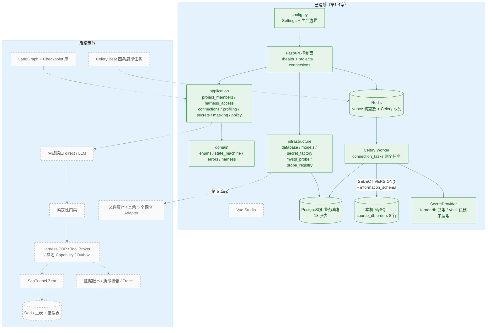
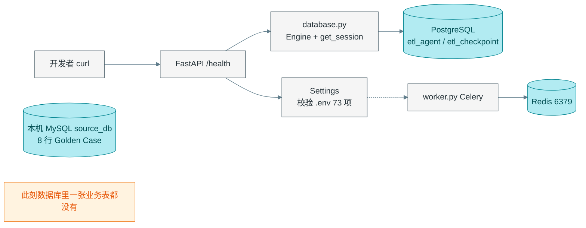
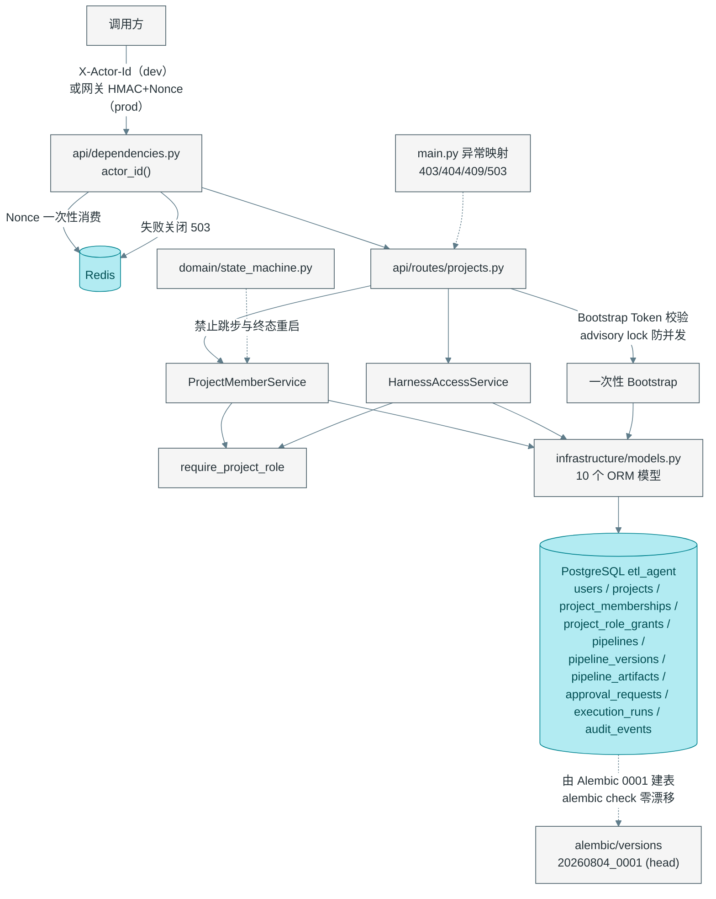
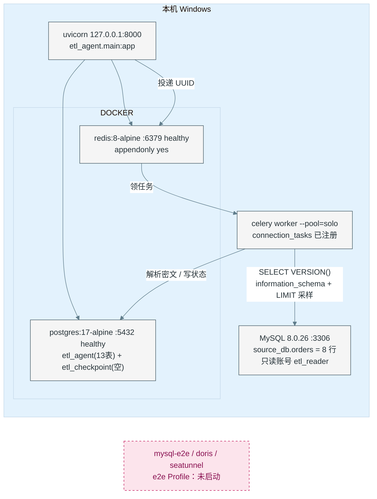
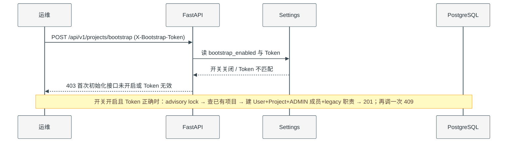
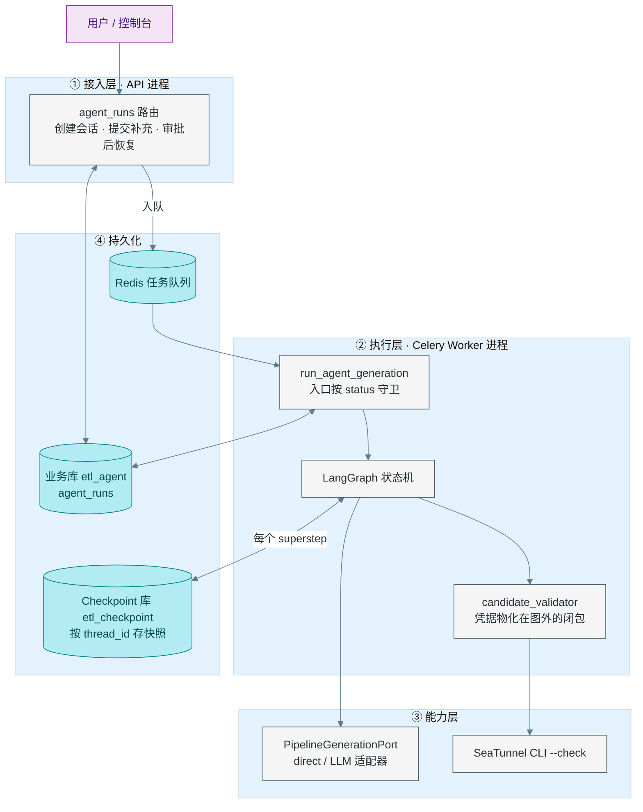
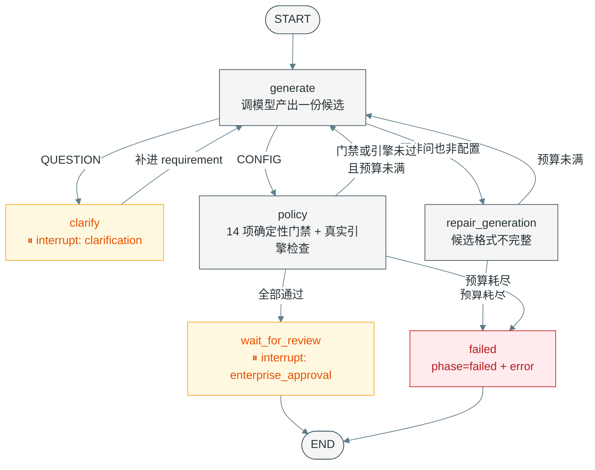
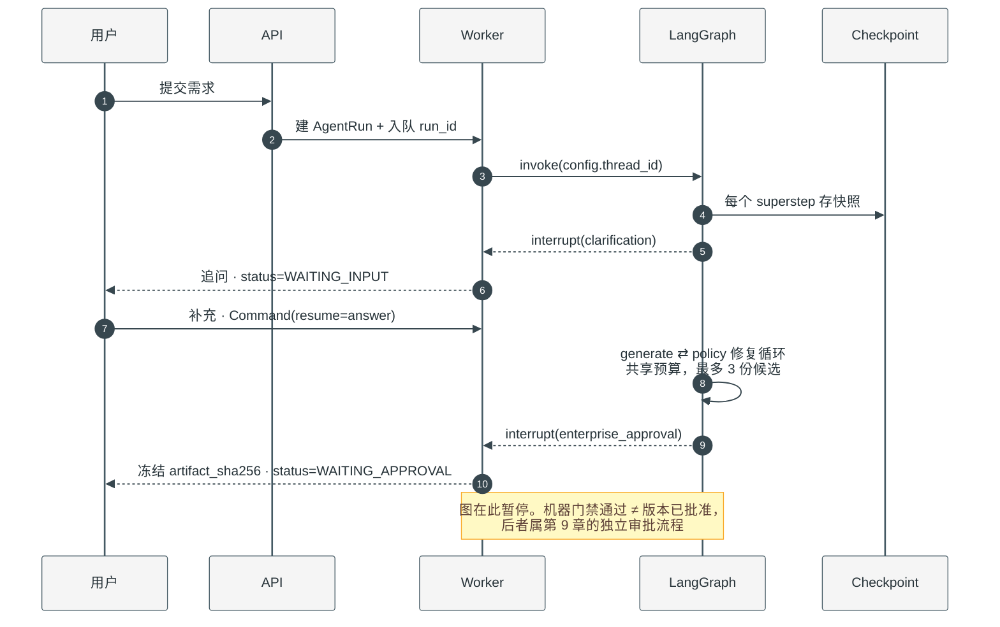

# 实现步骤说明与逐步架构图

> 工作项目 `etl_agent_demo`。**[2026-10-15 复核修订]** 第 1–15 章代码全部落地：迁移单 head
> `20260804_0012`（13 个迁移文件）、PostgreSQL 业务库 30 张表（另有 `alembic_version`）、
> `uv run pytest tests` **135 passed**、`ruff check` / `ruff format --check` / `mypy --strict` 全绿、
> `alembic check` 零漂移。
>
> **但「代码落地」不等于「全链跑通」**，不要把本节读成"全量验收通过"：e2e Profile（MySQL / Doris /
> SeaTunnel）因 `infra/seatunnel/` 缺 Dockerfile 而**无法启动**，所以 Doris 影子表原子发布、Golden Case
> 端到端、运行时监督与 9 类副作用的实机行为都还没有证据；LangGraph Checkpoint 仍是
> `NotImplementedError` 骨架；`pipeline_schedules` 表未建，调度与水位仍是 no-op。
>
> 下方各章节表格保留的是**当时**的实测快照。凡标注「历史快照」的段落（例如"数据库停在
> `20260804_0002`、只有 14 张表"）描述的是修订前的状态，**不代表当前状态**。
>
> 图中实线 = 已存在且已验证；虚线 = 课件规划但尚未到章节，明确不建。

---

## 一、每一步在做什么（按实际执行顺序）

### 第 1 章：把问题钉死

| 步 | 动作 | 产出 | 为什么要这一步 |
|---|---|---|---|
| 1.1 | 从 §1.2 提取 MySQL 初始化脚本 | 8 行固定教学数据（1001–1008） | 后面所有"清洗对不对"都要有可比对的基准，不能靠口头描述 |
| 1.2 | 本机建 `source_db.orders` 并灌数 | 8 行数据 | 提供真实可查的 Source，而不是假设 |
| 1.3 | 按清洗契约复核 Golden Case | 有效 4 / 拒绝 1+1+2 / 去空格 / 邮箱脱敏 | 把"提高数据质量"变成逐条可判的规则，验收才有客观依据 |

### 第 2 章：搭工程底座

| 步 | 动作 | 产出 | 为什么要这一步 |
|---|---|---|---|
| 2.1 | `config.py` 配置入口 | 73 项 `ETL_AGENT_*` + 启动期生产边界校验 | 危险配置组合必须在启动时失败，不能等跑到第 11 章才炸 |
| 2.2 | 修复秘密泄漏 | `ConfigurationError` 脱敏消息 | 校验失败的日志原本会把 HMAC 密钥原文打出来 |
| 2.3 | `main.py` + `/health` | 四字段就绪探针 | 给服务一个"活着吗、配置齐了吗"的窗口，且不读秘密 |
| 2.4 | `infrastructure/database.py` | 异步 Engine + `get_session()` | 固定"一次请求一个会话、不自动提交"的边界 |
| 2.5 | `worker.py` | Celery 装配（JSON / acks_late / prefetch=1） | 慢任务与 API 分进程，故障才能被区分 |
| 2.6 | Compose 起 postgres + redis；核对 `postgres-init.sql` | 两库分账号 + 两个 DSN 连通 | 业务真相与会话恢复物理隔离 |
| 2.7 | 填 Fernet 主密钥、建 `var/` 三目录 | `.env` 就绪 | fernet-db 模式没主密钥就永远 configured=false |

### 第 3 章：写入企业事实

| 步 | 动作 | 产出 | 为什么要这一步 |
|---|---|---|---|
| 3.1 | `domain/enums.py`、`harness.py::HarnessRole` | 28 个枚举 + 5 个职责 | 状态必须是固定词汇，否则 API/库/Worker 各写一套 |
| 3.2 | `domain/errors.py` | `DomainError` + 5 个子类 | 课件从未给这份清单，但十条验收场景全靠这些异常名 |
| 3.3 | `infrastructure/models.py` | 10 个 ORM 模型 | 版本、审批、执行、审计第一次有了持久化形状 |
| 3.4 | `alembic/versions/20260804_0001_initial.py` + `upgrade head` | 库里 10 张业务表 | 结构变更必须有版本号和回滚，不能靠启动时 `create_all` |
| 3.5 | `domain/state_machine.py` | 显式迁移表 + 4 个校验函数 | 枚举只说"有哪些值"，不说明"值之间怎样变化" |
| 3.6 | `api/dependencies.py` | dev-header 与可信网关 HMAC + Redis Nonce | 生产不能信裸请求头；Redis 挂了就 503，不许降级放行 |
| 3.7 | `application/profiling.py`（只放 `require_project_role`）+ `harness_access.py` + `project_members.py` | 项目角色与服务端权限判断 | 越权必须在服务端被拒，不能靠前端藏按钮 |
| 3.8 | `api/routes/projects.py` + `api/schemas.py` | bootstrap / members / harness-roles 三个端点 | 一次性 Bootstrap 建首位管理员，之后才能授权别人 |
| 3.9 | `main.py` 注册路由 + `DomainError→HTTP` | 403/404/409/503 映射 | 收敛第 2 章 DEV-3；错误语义要稳定 |
| 3.10 | `tests/conftest.py` + 四个测试 | 14 个用例全绿 | 本章真正的验收是**失败路径**：错 Token、重复、越权、重放、跳步、原地重启 |

### 第 4 章：接入异构数据库并安全探查元数据

| 步 | 动作 | 产出 | 为什么要这一步 |
|---|---|---|---|
| 4.1 | 定口径：探查目标 `source_db.orders`、只读账号 `etl_reader` | 本机 MySQL 新增仅 `SELECT ON source_db.*` 的账号 | 平台不该拿 root 去探业务库；最小权限是课件原则，也是失败时损失可控的前提 |
| 4.2 | `application/secrets.py`（415 行，5 个清单符号） | `ConnectionCredentials` + `SecretProvider` 协议 + Fernet / Vault KV v2 / Routing 三种实现 | 凭据是用户数据不是平台配置；协议隔离让"本地加密存 PG"与"企业 Vault"可互换 |
| 4.3 | `infrastructure/secret_factory.py`（70 行）并删除第 2 章临时文件 | `/health` 改回委托 `secret_provider_readiness()`；收敛 DEV-2 | 就绪判断只能返回 Provider 名与布尔值，不能回显 Token、地址或路径 |
| 4.4 | `application/profiling.py` 补全（220 行） | Port `MetadataProbePort`、`ConnectionTarget`/`TableProfileResult`、`ProfileService`、标识符与 HDFS 路径白名单 | 业务层只认接口；`PENDING→RUNNING→READY/FAILED` 与 `expires_at` 让 Profile 成为"有时效的快照" |
| 4.5 | `application/masking.py`（61 行）+ 最小 `application/policy.py`（26 行） | 保守脱敏规则；`require_safe_generation_context` 挡住 `options.password` 夹带 | 未知自由文本一律部分遮蔽；把秘密偷渡进 Agent 上下文的第二条路要在这里就堵死 |
| 4.6 | `application/connections.py`（154 行） | 权限校验 → 输入校验 → 凭据加密 → 审计事件，四件事一次做完 | 审计只记名称/Connector/主机/端口/库名，不记 `secret_ref`、用户名、密码与 Vault 路径 |
| 4.7 | `models.py` 加 3 个模型 + `alembic/versions/20260804_0002_connections_profiles.py` | 库里 13 张表；`alembic check` 零漂移 | 连接、密文、探查结果第一次有持久化形状；0002 一并建了参考实现放在 0013/0017/0018/0026 的列（见第 4 章任务表 DEV-6） |
| 4.8 | `infrastructure/mysql_probe.py`（168 行）+ `probe_registry.py`（27 行，仅 MySQL/DORIS） | 只查 `information_schema`，样本 `LIMIT %s` 参数化，返回前完成脱敏 | 探查 SQL 由平台固定写死，模型没有生成它的位置；未注册 Connector 直接失败关闭 |
| 4.9 | `connection_tasks.py`（104 行）+ `asyncio_compat.py`（22 行）+ `worker.py` 的 `include` | 两个 Celery 任务；驱动异常先 `redact_error()` 再入库 | 慢且不确定外部调用挪出请求路径；Windows 上 psycopg 不吃 Proactor，Worker 复用同一 Selector loop |
| 4.10 | `api/routes/connections.py`（199 行，7 端点）+ `schemas.py` 五个模型 + `main.py` 挂载 + 两个测试文件 | `POST /api/v1/connections`、`…/tests`、`…/profiles`、`/api/v1/data-profiles/{id}` 等；20 个用例全绿（本章 6） | 响应模型物理上不存在凭据字段，"不回显秘密"才是结构保证而不是约定；轮换策略端点本章不实现（DEV-5） |

### 第 5 章：把异构文件变成受管数据源

| 步 | 动作 | 产出 | 为什么要这一步 |
|---|---|---|---|
| 5.1 | `models.py` 加 `FileAsset` + `BigInteger` import | 14 个 ORM 模型 | 上传身份、内部 URI、引擎路径、解析结果四种事实需要一张表承载 |
| 5.2 | `alembic/versions/20260804_0003_managed_file_assets.py` | 库里 14 张表；`ix_file_assets_project_created` 索引 + 两条 CHECK | 迁移链衔接 0002→0003；字节数/行数非负约束在数据库层兜底 |
| 5.3 | `application/file_assets.py` — 文件名净化与格式白名单 | `format_for_filename()` / `source_relative_path()` / `_safe_filename()` | 客户端文件名只能当显示别名；未知扩展名立即失败，绝不"当文本试试看" |
| 5.4 | `infrastructure/file_asset_store.py` — 原子存储 | `LocalFileAssetStore.write_upload()` / `_resolve()` | 临时文件 + `open("xb")` + 流式 SHA-256 + 超限即删 + `replace()`；目录穿越防护用 `is_relative_to` |
| 5.5 | `api/routes/file_assets.py` — 三段事务上传 API | POST 202 PENDING / GET 列表 / GET 详情 | 第 1 段登记、第 2 段事务外落盘、第 3 段记 URI/hash 并投递 UUID；响应不含内部定位 |
| 5.6 | `api/schemas.py` — `FileAssetResponse` | 用 `validation_alias` 映射 `file_format`→`format`、`schema_json`→`schema_definition` | ORM 字段名与 API 响应字段名解耦；避免 shadow BaseModel.schema_json |
| 5.7 | `application/file_assets.py` — FileAssetService 状态机 | 8 个方法：request/record_stored/mark_running/complete/fail/list/get | 全部走 `SELECT … FOR UPDATE`；`complete` 写 normalized_uri/engine_path/Schema/统计/样本/行数/`expires_at=+24h` |
| 5.8 | `file_asset_tasks.py` + `worker.py` include | Worker 任务 `profile_file_asset(asset_id)` | 只接 UUID；读原文件→九种格式解析→写 JSONL→推进状态；异常只存固定文案 |
| 5.9 | 九种格式解析器 | CSV/JSON/JSONL/XLSX/Parquet/ORC/XML/Markdown/PDF | 统一成 `list[dict]` + Schema + 统计 + 脱敏样本；无文本 PDF 明确失败 |
| 5.10 | `_normalize_rows` / `_infer_schema` | 表头规范化（小写/下划线/数字开头补前缀/重名加后缀）；保守类型推断 | 原始名→规范名映射写进 `statistics` 供审查页解释；避免把任意文本吹成 bigint |
| 5.11 | `tests/unit/test_file_assets.py` — 6 个测试 | 锁九种格式的统一行模型、原子存储、上传 API 脱敏 | 第 7 个测试（Agent 集成）顺延到第 8 章；实测 6 passed |

### 第 6 章：ETL 契约验证与确定性生成

| 步 | 动作 | 产出 | 为什么要这一步 |
|---|---|---|---|
| 6.1 | `application/schema_contract.py` — 骨架与导入 | 引入 `_iter_named_block_bodies/spans`（来自 policy.py）、`DomainError`、正则表达式 | 7 个公开函数 + 15+ 内部辅助函数；共 964 行 |
| 6.2 | `policy.py` 补充两个 HOCON 解析函数 | `_iter_named_block_spans()` / `_iter_named_block_bodies()` | 按平衡花括号扫描，忽略字符串和注释中的花括号；返回内容范围而非包含花括号 |
| 6.3 | `profile_contracts()` — 生成不可变快照 | 从 Profile 提取 schema/columns/table/role，剔除敏感信息 | LOCAL_FILE/HDFS/数据库分别冻结不同子集；快照不含 masked_sample/credential_placeholders |
| 6.4 | `require_profile_topology_contract()` — 拓扑门禁 | 统计每种 connector 期望数量，与 HOCON 实际块数对比 | 零期望也必须为零（fail-closed）；防止重复 Source 伪造行分流 |
| 6.5 | `require_managed_file_source_contract()` — 受管文件契约 | 校验 LocalFile 块的路径/格式/编码/字段类型 | 拒绝路径替换和 Schema 漂移；必须精确使用平台冻结的只读 JSONL |
| 6.6 | `canonicalize_managed_file_source_contract()` — 确定性编译 | 模型省略 schema.fields 时由平台补齐 | 多源场景不猜测，交由拓扑门禁拒绝 |
| 6.7 | `require_hdfs_file_contract()` — HDFS 端点绑定 | 校验 fs.defaultFS/remote_user 占位符、路径、格式、保存模式 | Source 需验证 schema.fields；Sink 需 ERROR_WHEN_SCHEMA_NOT_EXIST + APPEND_DATA |
| 6.8 | `require_database_endpoint_contract()` — 数据库端点绑定 | 逐一匹配 Jdbc/Doris/Hive 块与 Profile | URL/driver/凭据占位符/query 或 table 必须唯一对应 |
| 6.9 | `require_target_schema_contract()` — 目标 Schema 对齐 | Doris/JDBC/Hive/HDFS Sink 的 SQL 投影显式列出目标列 | 禁止 `*`；缺列/多列都会抛错 |
| 6.10 | 三个迁移文件 — 0004/0005/0006 | `agent_runs` 加 quality/incremental/row_llm_contract；`pipeline_schedules` 加水位列 | down_revision 依次衔接 0003→0004→0005→0006 |
| 6.11 | `tests/unit/test_schema_contract.py` — 17 个测试 | 覆盖五大类门禁 | 实测 17 passed；总测试数 43（14+6+6+17） |

---

## 二、逐步架构图

### 图 0 · 终态目标（第 15 章全景，虚线=尚未建）



### 图 1 · 第 2 章结束时（只有进程底座）



### 图 2 · 第 3 章结束时（有了身份与企业真相）



### 图 3 · 当前这台机器的真实进程拓扑（实测）



### 图 4 · 一次真实请求的时序（Bootstrap 二次调用）



### 图 5 · 第 4 章结束时（第一条元数据链路，实测时序）

```mermaid
%%{init: {'theme':'base', 'themeVariables': {'background':'#ffffff','primaryColor':'#f5f5f5','primaryBorderColor':'#455a64','primaryTextColor':'#263238','secondaryColor':'#e8f5e9','tertiaryColor':'#e3f2fd','lineColor':'#607d8b','edgeLabelBackground':'#ffffff','actorBkg':'#f5f5f5','actorBorder':'#455a64','actorTextColor':'#263238','signalColor':'#37474f','signalTextColor':'#263238','labelBoxBkgColor':'#eceff1','labelTextColor':'#263238','noteBkgColor':'#fff9c4','noteBorderColor':'#f9a825','noteTextColor':'#5d4037','sequenceNumberColor':'#ffffff'}}}%%
sequenceDiagram
    participant E as 数据工程师
    participant API as FastAPI
    participant SP as SecretProvider(fernet-db)
    participant PG as PostgreSQL
    participant Q as Redis/Celery
    participant W as Worker
    participant DB as MySQL source_db

    E->>API: POST /api/v1/connections（含 etl_reader 凭据）
    API->>API: require_project_role + require_safe_generation_context
    API->>SP: store(credentials)
    SP->>PG: 密文 184 字节 + 连接元数据 + 审计（无 secret_ref/密码）
    API-->>E: 201（15 字段，无 credentials/password/secret_ref）
    E->>API: POST /api/v1/connections/{id}/tests
    API->>PG: status=TESTING
    API->>Q: 只投递 connection_id
    API-->>E: 200 TESTING
    Q->>W: 领取任务
    W->>PG: 按 secret_ref 解析凭据（明文只在内存）
    W->>DB: SELECT VERSION()
    W->>PG: status=READY（失败则 redact_error 后写 FAILED）
    E->>API: POST /api/v1/connections/{id}/profiles {source_db, orders, 20, SOURCE}
    API->>API: 标识符白名单：orders; DROP TABLE users → 400
    API->>PG: DataProfile PENDING
    API->>Q: 只投递 profile_id + sample_limit
    API-->>E: 202 PENDING
    W->>DB: information_schema 列/主键/统计 + ORDER BY 主键 LIMIT %s
    W->>W: mask_sample：邮箱 a***@example.com，姓名 B***b
    W->>PG: READY + schema_json + primary_keys + masked_sample + expires_at(+24h)
    E->>API: GET /api/v1/data-profiles/{id}
    API-->>E: 结构化元数据与脱敏样本（8 行，主键 order_id）
```

**秘密在这张图上的位置**：API 摸到凭据但不查库；队列只传 UUID；Worker 只在调 Adapter 前解密；Adapter 返回前完成脱敏。四处的落库/落日志结果本机都查过：密文里搜不到明文、审计只有 name/connector/host/port/database、`api.log` 与 `worker.log` 各 0 次命中。

---

## 二-B、第 8 章 LangGraph 架构图（代码已有形状，本机尚未跑通）

> ⚠️ **这三张图不遵循文首图例，虚实线在这里没有区分度。** 第 8 章**已经在开工，且比想象中走得远**：
> `agent/graph.py` 与图 7 的六个节点逐个对得上，`agent_runs` 的服务层、ORM、路由都写完了。
> 但"代码存在"和"这条链路能在这台机器上跑一次"是两件事，下面逐条给实测结果。
> 因此图里全画实线表示**形状目标**，落地程度看这张表：

| 图上的框 | 状态 | 实测依据（2026-10-15） |
|---|---|---|
| LangGraph 状态机（图 7 六节点） | ✅ 代码在，可 import | `agent/graph.py` 13.8 KB；`from etl_agent.agent.graph import build_generation_graph` 通过，`MAX_ENTERPRISE_REPAIR_ATTEMPTS = 2` |
| `PipelineGenerationPort` | ✅ 代码在 | 第 7 章已接，mock / direct 两个适配器 |
| agent_runs 路由（图 6 ① 接入层） | ✅ 代码在 | `api/routes/agent_runs.py` 四个端点，POST 建 `QUEUED` 后 202 |
| AgentRunService / ORM | ✅ 代码在 | `application/agent_runs.py`、`infrastructure/agent_run_model.py` |
| `agent_runs` 表 | ✅ 已建（历史快照：曾缺失） | **2026-10-15 复核**：`alembic current` = `heads` = `20260804_0012`，业务库 30 张表，`agent_runs` 与 `file_assets` 均已存在。此前"数据库停在 `20260804_0002`、只有 14 张表"的记录是未执行 `alembic upgrade head` 时的历史快照 |
| `run_agent_generation`（图 6 ② 执行层） | ✅ 已存在（历史快照：曾缺失） | `agent_tasks.py` 已落地，`worker.py` 的 `include` 现登记 8 个任务模块（connection / file_asset / heartbeat / agent / execution / schedule / harness_outbox / side_effect），`run_agent_generation` 在 Worker 任务清单中可见 |
| Checkpoint 库 `etl_checkpoint`（图 6 ④） | ❌ 只有骨架 | `agent/checkpoint.py` 的 `create_checkpoint_saver()` 直接 `raise NotImplementedError`（注释写明需接 `langgraph-checkpoint-postgres`，包本身已安装） |
| 两个 `interrupt()` 与恢复（图 7、图 8） | ❌ 未验证 | 依赖上面的 Worker 入口 + Checkpoint；`/agent-runs/{id}/steps` 端点自己在 docstring 里承认是先按状态推导的 mock 步骤 |
| 本章测试 | ❌ 未写 | `tests/unit/` 里没有 `test_agent_runs.py` |

一句话：**图 7 的形状是对的，图 6 里"② 执行层"和"④ Checkpoint 库"两个框还只是目标态。**

### 图 6 · 第 8 章 · 分层架构（② 执行层与 ④ Checkpoint 仍是目标态）



**读图三条边界**：Checkpoint 与业务库物理分库、不复用同一个 Session；凭据只活在 Worker 的闭包里，不进图状态；API 从不跑图，跑图的只有 Worker。

### 图 7 · 第 8 章 · 图内状态机（6 节点，与 `agent/graph.py` 逐节点对得上）



三条回边指向 `generate` 是合法回边，不是终态重启——`generate` 从来不是终态。黄色两个节点是图会真正停下来、状态写进 `agent_runs` 的地方。

### 图 8 · 第 8 章 · 时序概括（目标态，本机未跑通过一次）



**两个中断点与状态对应**

| `interrupt()` 所在节点 | `kind` | `AgentRunStatus` | 谁能恢复 |
|---|---|---|---|
| `clarify` | `clarification` | `WAITING_INPUT` | 提需求的人补一句 |
| `wait_for_review` | `enterprise_approval` | `WAITING_APPROVAL` | 只能由 API 验过角色、版本、审批记录后触发 |

恢复统一是 `invoke(Command(resume=值), {"configurable": {"thread_id": ...}})`——同一个 `thread_id` 才接得上同一条会话。

**一条最关键的约束**：`MAX_ENTERPRISE_REPAIR_ATTEMPTS = 2`（即最多 3 份候选），而且这个预算是三种失败共享同一个 `repair_count`：候选格式不完整、企业门禁未过、SeaTunnel 引擎检查未过。分开计数会让模型无限自循环烧 token，共享才把总成本钉死。

附带一条顺序约束：真实引擎检查必须排在人工审批中断**之前**，否则坏候选已经摆在审批人面前、修复预算也用不掉了。

---

## 三、往图上继续加东西的顺序


| 章节 | 会新增的框 | 依赖哪条现有边 |
|---|---|---|
| ~~第 4 章~~ ✅ 代码+已跑通 | 连接与探查链路、SecretProvider、DataProfile（见图 3、图 5）；其余 5 个探查 Adapter 与凭据轮换端点仍缺 | `UV → RD → WKR → MY` 已接通 |
| ~~第 5 章~~ ✅ 代码在 | 文件资产 `var/file-assets`、九种格式解析器、三段事务上传 API、Worker 异步解析 | `var/` 三目录已建；`DataProfileStatus` 与脱敏规则可直接复用 |
| ~~第 6 章~~ ✅ 代码在 | ETL 契约验证系统（schema_contract.py）、Profile 快照生成、拓扑门禁、受管文件/HDFS/数据库端点绑定、目标 Schema 对齐、三个 JSON 列迁移 | `domain/enums.py` / `policy.py` 已就位；17 个测试全绿 |
| 第 7 章 ✅ 代码在 | 生成端口（mock / direct 适配器，`infrastructure/generation_factory.py`）、GenerationRequest/Result、预算控制；SeaTunnel CLI 适配器归第 10 章 | `application/schema_contract.py` 所有门禁函数 |
| 第 8 章 🟡 半（2026-10-15 复核） | LangGraph 六节点状态机 ✅、AgentRunService/ORM/路由 ✅、**Celery `agent_tasks.py` ✅**、**`agent_runs` 表 ✅**；仍缺 **Checkpoint ❌（`create_checkpoint_saver` 直接 raise）；`test_agent_runs.py` 未写** | 第 7 章 GenerationPort；`etl_checkpoint` 库存在但为空 |
| 第 9 章 ✅ 代码在 | 版本冻结与四眼审批：`application/pipelines.py`、`application/approvals.py`、`api/routes/approvals.py` + PipelineVersion/PipelineArtifact/ApprovalRequest 表 | 第 8 章 AgentRunService |
| 第 10 章 🟡 半（2026-10-15 复核） | `application/execution*.py`、`infrastructure/seatunnel/zeta_adapter.py`、`api/routes/executions.py` ✅、**Celery `execution_tasks.py`（submit/monitor）✅**、**Beat 四条周期任务已登记 ✅**；仍缺 **真实 SeaTunnel 提交与监控链路（e2e Profile 未启用）** | `worker.py` 现登记 8 个任务模块 |
| 第 11–13 章 🟡 代码为主 | Harness PDP（`harness_policy.py`）、ToolBroker、签名 Capability、Evidence Ledger、Outbox（`harness_outbox_tasks.py`）✅；运行时监督 `domain/supervision.py` + `runtime_supervision.py` ✅；副作用治理 `side_effect_harness.py`（860 行，prepare→decide→commit 四步）✅ | `project_role_grants`、`execution_runs` |
| 第 14–15 章 🟡 | Benchmark、安全进化的 domain/application/路由/CLI ✅；控制台七份 service ✅；e2e Profile 全链仍未启用 | Doris/SeaTunnel 届时启用 |

**（历史快照，2026-10-15 复核已解除）** 上表记录的是当时本机被一条边卡住的状态：
`alembic heads` = `20260804_0011`，但数据库 `alembic_version` 仍是 `20260804_0002`，`etl_agent` 库只有
14 张表，第 5 章以后的 `file_assets`、第 8 章的 `agent_runs` 以及副作用/监督/Benchmark 的表一张都不存在——
因为 98 个单测走的是 `tests/conftest.py` 的内存 SQLite，不碰 PostgreSQL，缺表问题只有在真实路由被调用时才暴露。

**当前状态**：`alembic current` = `heads` = `20260804_0012`，业务库 30 张表，上述缺表问题已解除；
该"边"不再是本机的卡点。现在真正的卡点是 e2e Profile 无法启动（缺 Dockerfile）与 Checkpoint 骨架，
见本文开头的修订说明。

---

## 四、看图时要记住的四件事

1. **模型只在候选生成环节出现。** 从图 0 可以看到，LLM 那条线在门禁之前；探查、校验、审批、签名、提交全是确定性代码。这不是风格选择，而是提示注入和模型超时时的失败关闭点。第 4 章是这条原则最直白的证据：探查 SQL 由平台写死，模型连生成它的机会都没有。
2. **三层状态不能互相冒充。** 图 2 里 `AgentRun`（会话层）、`PipelineVersion/ApprovalRequest/ExecutionRun`（治理层）和未来的 SeaTunnel Job（引擎层）分属不同表，谁也不能覆盖谁的状态。同理，本章 `DataConnection.status`（连接是否可用）与 `DataProfile.status`（一次探查是否完成）也是两件事。
3. **虚线就是"还没到章节"。** 本文所有虚线框都刻意没建，包括 e2e Profile、Checkpoint 表、Beat 四条周期任务；把它们画出来是为了防止误以为已经可用。第 4 章把 SecretProvider 与 Celery Worker 从虚线挪进了实线，但**Vault Provider 只是"代码在、配置未启用"**。
4. **Profile 是快照不是 Schema。** 它带 `expires_at`（本章 +24h）和状态机；第 6 章把契约绑到具体 Profile 上，正是为了在 Schema 漂移时能显式失败，而不是拿旧事实默默继续。
